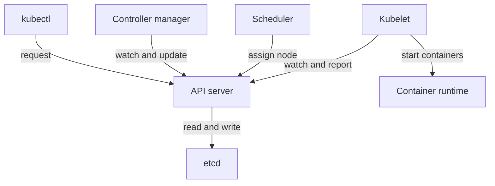
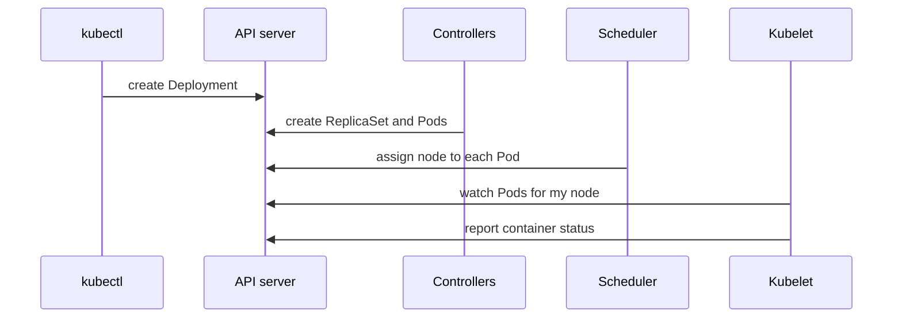

# Control Plane And Worker Responsibilities

A team declares that the `scout` application needs three running copies. Kubernetes does not start three processes inside the application programming interface (API) server. It stores the request, creates workload objects, chooses nodes and asks node software to run containers. This part names each component that does one of those jobs, shows where it runs in a real cluster and follows one request from the first call to a running container.

## The components and what each one does

A cluster is the group of machines and components that run workloads through one API. The control plane is the set of components that store cluster state and make decisions about it. A worker node is a machine that runs the containers. A Pod is the smallest deployable unit: one or more containers that run together on one node.

The control plane has four main components:

- The API server (`kube-apiserver`) receives every request, checks it and exposes the cluster API. It is the only component that talks to the datastore.
- The datastore, `etcd`, is a consistent key-value database. It persists every object the cluster knows about.
- The scheduler (`kube-scheduler`) picks a node for each Pod that has no node yet.
- The controller manager (`kube-controller-manager`) runs the built-in controllers. A controller is a loop that watches objects and creates, updates or deletes other objects to match what was requested.

Each worker node runs three kinds of software. The kubelet is the node agent: it watches the API for Pods assigned to its node, makes them run and reports their status. The container runtime, for example containerd, pulls images and starts and stops containers. The network component, often `kube-proxy`, programs the node so that traffic to a Service reaches a Pod. Some clusters replace `kube-proxy` with the network plugin.


Every component talks to the API server, and only the API server talks to etcd.

## See the components in the playground

Reading a list of names is easier once you have seen the names on a real cluster. The control plane components run as Pods in the `kube-system` namespace. Run this command to list them with the node each one runs on.

<!-- astrona:playground:renew -->

```sh
kubectl -n kube-system get pods -o wide
```

You see one Pod for the API server, one for `etcd`, one for the scheduler and one for the controller manager. Their names end with the name of the control plane node, because the kubelet on that node starts them from files on disk. These are called static Pods. The same list shows the cluster DNS Pods, a `kube-proxy` Pod on each node and the network agent Pods. The worker node has no API server, no `etcd` and no scheduler.

Next, list the nodes and read the roles.

```sh
kubectl get nodes -o wide
```

The control plane node has the role `control-plane`. The worker node has no role. The last columns show the container runtime version on each node, which names containerd.

## Following a Deployment request

Assume a client submits a Deployment whose Pod template names an available image and whose specification asks for three replicas. The API server authenticates the client, checks that it may do this and applies admission checks. It then stores the Deployment in `etcd`. At this point no application process exists. Only the desired configuration is accepted.

The Deployment controller, which runs inside the controller manager, sees the new Deployment and creates a ReplicaSet. A ReplicaSet is a resource that keeps a requested number of identical Pods running. The ReplicaSet controller then creates three Pod objects. Both controllers write through the API server. They never write to `etcd` directly.

The scheduler sees each Pod that has no node. It looks at resource requests and placement rules and writes the chosen node into the Pod. The kubelet on that node sees the assignment, prepares storage and the Pod network, asks the runtime to pull the image and start the containers, and reports status back to the API server. A readiness check then decides whether the Pod receives Service traffic.


The Pod object exists long before a container runs, and each step is done by a different component.

You can watch this chain on the playground. Save this as `deployment-bridge.yaml`:

```yaml
apiVersion: apps/v1
kind: Deployment
metadata:
  name: bridge
  namespace: starfleet
spec:
  replicas: 3
  selector:
    matchLabels:
      app: bridge
  template:
    metadata:
      labels:
        app: bridge
    spec:
      containers:
        - name: bridge
          image: ghcr.io/stefanprodan/podinfo:6.15.0
```

Apply it:

```sh
kubectl apply -f deployment-bridge.yaml
```

Then check the result:

```sh
kubectl -n starfleet get deployment,replicaset,pod -l app=bridge
kubectl -n starfleet get events --sort-by=.metadata.creationTimestamp
```

The first command shows one Deployment, one ReplicaSet and three Pods that came from one request. The events show which component acted: the Deployment controller scaled the ReplicaSet, the scheduler assigned each Pod to a node, and the kubelet pulled the image and started the container.

## Failure boundaries

Because each step belongs to a different component, a failure stops at one step and leaves the earlier steps complete. If the API server is unavailable, no new request is accepted, but containers that already run keep running. If the scheduler is unavailable, an accepted Pod waits with no node, and its `Pending` status has no assigned node. If the runtime on one node fails, Pods on that node cannot start while Pods on another node continue.

The practical rule for a scenario question is to find the last step that completed. A Pod with a node but no running container points to the kubelet, the runtime, the image or the network setup. A Pod with no node points to the scheduler or to a lack of capacity.

You now know the components, where they run and the order in which one request touches them. The open question is how the cluster keeps the result correct after the first run, when Pods are deleted or nodes fail.

## Common pitfalls

> [!WARNING]
> - **Giving the scheduler the job of running containers.** The scheduler only writes a node name. The kubelet and the runtime start the containers.
> - **Thinking `etcd` runs workloads.** `etcd` stores state and nothing else.
> - **Believing controllers write to `etcd`.** Every component except the API server uses the API.
> - **Reading a running container as proof that the control plane is healthy.** Running containers survive a control plane outage, but new requests, replacements and scheduling do not.
