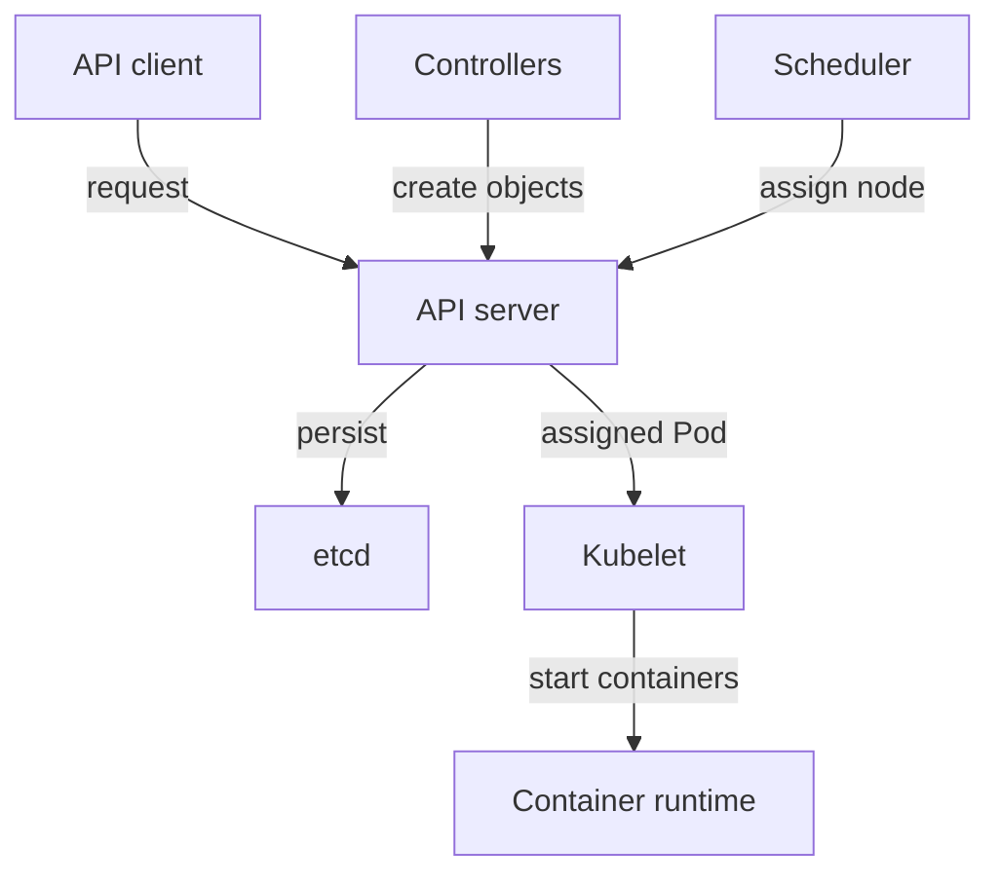

# Control Plane And Worker Responsibilities

A team declares that the `scout` application needs three running copies. Kubernetes does not start three processes inside the application programming interface (API) server. It stores the request, creates workload objects, chooses nodes and asks node software to run containers. A cluster is the collection of these cooperating machines and components.

The control plane manages the cluster. The API server receives resource requests, checks them and exposes the cluster API. The etcd datastore persists cluster configuration and object state. Controllers watch resources and act when observed state differs from requested state. The scheduler selects a suitable node for a Pod that has not yet been assigned. A Pod is the smallest deployable Kubernetes unit and contains one or more containers.

A worker node provides resources for workloads. Its kubelet is the agent that makes assigned Pods run and reports their status. The container runtime starts and stops containers on the node. Networking components implement communication between Pods and Services. A Service gives clients a stable way to reach a changing group of backends. Some clusters use kube-proxy for Service forwarding; others implement it through their network plugin.

The API connects the control plane decisions to the node agent; etcd stores state rather than running containers.

A failed scheduler can delay new placement even while existing containers continue running. A failed runtime affects container execution on its node. Separating these responsibilities helps identify the likely component from the symptom.

## Following A Deployment Request

Assume a client submits a Deployment whose Pod template identifies an available image and whose specification asks for three replicas. The API server authenticates the client, checks authorization and applies the relevant admission checks. It stores the accepted Deployment in etcd. At this point, the three application processes do not need to exist yet; only their desired configuration has been accepted.

The Deployment controller observes that configuration and creates or updates a ReplicaSet. The ReplicaSet controller creates the missing Pod objects through the API. These are separate controller actions, which explains why several related objects appear from one submitted declaration. Controllers use the API rather than bypassing it to write directly into etcd.

The scheduler notices each Pod without a node assignment. It considers resource requests and placement constraints, then records an assignment. The chosen node's kubelet observes that assignment and coordinates preparation. Storage must be available, the Pod network must be configured and the runtime must obtain the container image before the process can run. These activities can involve storage and networking plugins as well as the runtime.

The kubelet reports container and Pod status. Controllers use reported state to decide whether more work is needed. A readiness check can then establish that a replica is eligible for ordinary Service traffic. The sequence connects accepted intent to usable application capacity through several independently failing steps.

Now compare three interruptions. If API access is unavailable, a new request cannot be accepted through the normal path. If the scheduler is unavailable, an accepted Pod can wait without an assignment. If one node's runtime is unavailable, its assigned Pod can fail to start while Pods on another node continue. These are different failure boundaries, so the evidence should identify the last completed step.

## Reading The Component Boundaries

The control plane manages decisions and stored state; worker components implement execution. This separation also explains why running containers can survive a temporary control plane interruption while updates stop progressing. Continued execution is not evidence that new requests, replacement or scheduling are healthy.

## Common pitfalls

> [!WARNING]
> The scheduler chooses a node; the kubelet and runtime execute containers. Do not assign both jobs to the API server or to etcd.
