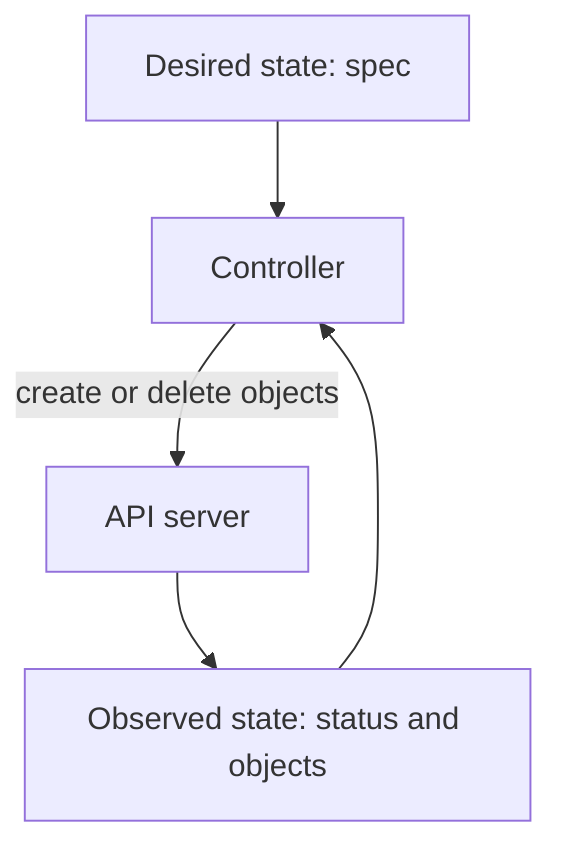

# Desired State And Reconciliation

The `scout` application needs three replicas, but only two Pods remain after a failure. A replica is one copy of the workload. Kubernetes does not need a person to notice this. A controller compares the number of replicas that were requested with the number that exist and creates the missing one. This part explains the fields that hold each side of that comparison, the loop that closes the difference and the limits of the repair.

## Specification and status

Most Kubernetes resources have two top-level fields that matter here. The `spec` field holds the desired state: what the author asks for. The `status` field holds the observed state: what the controllers and the kubelet report. Users write `spec`. Components write `status`. A request that changes `status` through the normal API does not change the real world.

You can read both sides on the playground. Run these commands to see the requested and the reported replica counts of the `scout` Deployment.

<!-- astrona:playground:renew -->

```sh
kubectl -n starfleet get deployment scout -o jsonpath='{.spec.replicas}{"\n"}'
kubectl -n starfleet get deployment scout -o jsonpath='{.status.readyReplicas}{"\n"}'
```

The first command prints the desired count from `spec`. The second prints how many replicas the Pods report as ready, from `status`. When the Deployment is healthy, the two numbers match. When they differ, something between the accepted request and a ready container has not finished.

A Deployment is a resource for managing replaceable application replicas and updates. It owns ReplicaSets, and each ReplicaSet owns Pods. Accepting the Deployment request proves only that the object was valid and stored. The ReplicaSet controller, the scheduler and the kubelet still have to act, and each can be blocked by a missing image, too little node capacity or an unavailable volume.

## The control loop

A control loop has the same three steps every time. The controller reads the desired state, reads the observed state and takes the smallest action that moves the observed state toward the desired state. Then it repeats. Controllers do not poll the datastore. They use a watch on the API server, so a change to an object wakes the controller that cares about it.


The controller never edits the result directly. It changes objects, and other components act on them.

Apply this to a Deployment. The ReplicaSet controller counts the Pods that match the ReplicaSet and carry its owner reference. If the count is lower than `spec.replicas`, it creates Pod objects. If the count is higher, it deletes Pods. It does not start containers. The new Pod object is a request that the scheduler and the kubelet must still carry out.

## Watch a controller repair a deletion

Seeing the loop work is the quickest way to remember it. First scale `scout` to three replicas and wait until they are ready.

```sh
kubectl -n starfleet scale deployment scout --replicas=3
kubectl -n starfleet rollout status deployment scout
```

Now list the Pods, pick one name and delete it. In a second terminal, or right after, list the Pods again.

```sh
kubectl -n starfleet get pods -l app=scout
kubectl -n starfleet delete pod <POD_NAME>
kubectl -n starfleet get pods -l app=scout
```

Replace `<POD_NAME>` with one of the names from the first command. The second listing shows three Pods again. One of them has a new name and a young age. The ReplicaSet controller saw only two matching Pods, so it created a new Pod object, the scheduler assigned a node, and the kubelet started the container. The new Pod is a different object with a new name and a new unique identifier. It does not carry the memory or the address of the deleted Pod.

Last, read what the controller recorded.

```sh
kubectl -n starfleet get events --sort-by=.metadata.creationTimestamp
```

The events include a `SuccessfulCreate` event from the `replicaset-controller` for the new Pod. This event names the component that did the work, which is the evidence a scenario question usually asks for.

## Three counts that are not the same

During recovery three values can disagree. The desired count is `spec.replicas`. The observed count is the number of Pod objects the ReplicaSet owns. The available count is the number of replicas that have been ready long enough to receive traffic. A new Pod object raises the observed count at once, but the available count rises only after the container starts and passes its readiness check.

If the image of the replacement cannot be pulled, the observed count is correct and the available count is not. Creating more Pod objects does not fix that, because the controller has done its job and a different component is blocked. In that case the Pod status and its events point to the kubelet and the image registry, not to the ReplicaSet.

A manual change to one Pod is also temporary. If the ReplicaSet replaces that Pod later, the new Pod comes from the Pod template in the Deployment, not from the manual change. Durable changes belong in the Deployment, because its template is the source for every new replica.

## What self-healing does not promise

Reconciliation repairs only the state that a controller knows how to manage. A Deployment can start another web process, but it cannot restore the unfinished transaction that the lost process held in memory. The application needs durable storage and safe retries for that.

A controller also keeps retrying a request that the environment cannot satisfy. The retries are useful because a missing dependency may return, but they are not proof that the request can succeed. To explain a stuck workload, name the desired state, the corrective action and the dependency that still blocks it.

You now know that `spec` and `status` are two sides of a comparison, that controllers close the gap through the API and that the repair has limits.

## Common pitfalls

> [!WARNING]
> - **Treating an accepted request as a finished one.** The API server accepts a valid object long before any container runs.
> - **Editing `status`.** Components own it. Change `spec` instead.
> - **Fixing a managed Pod by hand.** The next replacement comes from the template, so the fix disappears.
> - **Reading three Pod objects as three working replicas.** Check the available count, not only the object count.
