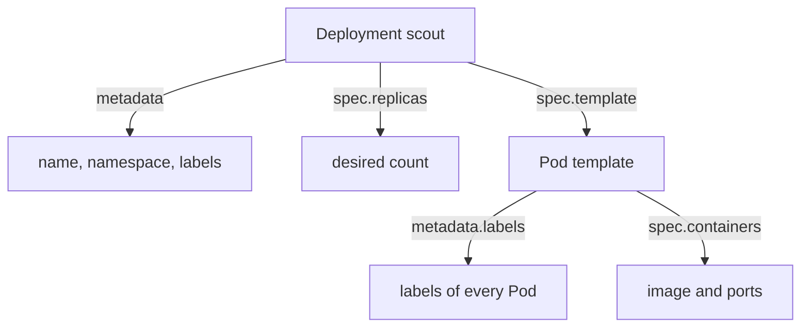

# Objects, Scope And Identity

Consider a Deployment named `scout` in a namespace named `starfleet`. To change it, to find it or to explain what it does, you must know what the record contains and where its name is valid. This part reads the four top-level fields of an object, separates namespaced resources from cluster resources and explains how the API tells two objects with the same name apart.

## The parts of an object

A Kubernetes object is a stored record that describes one resource. YAML is the text format that people usually use to write these records. Indentation shows which field belongs to which parent, so a field at the wrong level is a different configuration or a rejected one. Four top-level fields appear in almost every object:

- `apiVersion` names the API group and version that define the schema, for example `apps/v1` for a Deployment and `v1` for a Pod.
- `kind` names the resource type, for example `Deployment`.
- `metadata` holds identity: the name, the namespace, labels, annotations and the unique identifier.
- `spec` holds the desired state. Many objects also have `status`, which components fill in with what they observe.

Read these fields from the cluster on the playground. The command prints the first lines of the `scout` Deployment as the API stores it.

<!-- astrona:playground:renew -->

```sh
kubectl -n starfleet get deployment scout -o yaml | head -n 40
```

You see `apiVersion: apps/v1` and `kind: Deployment` first. Under `metadata` you see the name, the namespace, a `uid`, a `creationTimestamp` and a `generation`. Fields that you did not write, such as `uid`, come from the API server. Keep reading down to `spec` and `status` and compare the replica counts in both.

## Ask the API what a field means

You do not need to remember every field. The command `kubectl explain` prints the schema that the API server publishes for a resource, with a description of each field.

```sh
kubectl explain deployment.spec.replicas
kubectl explain deployment.spec.template.metadata
```

The first command describes the replica count. The second shows that a Deployment has metadata in two places: its own `metadata`, and `spec.template.metadata` for the Pods it creates. The two are independent. A label that you add only to the Deployment does not appear on its Pods. If a Service expects `app: scout` on the Pods, the Pod template must carry that label.


The Pod template carries its own metadata, separate from the Deployment's metadata.

## Namespaced and cluster resources

A namespace is a named scope inside a cluster. Most resource names must be unique only inside one namespace, so two Deployments named `scout` can exist in `starfleet` and in `outpost`. A namespace also scopes access rules and quotas. It does not isolate network traffic by default, and it is not a separate cluster.

Some resources have no namespace. A Node, a Namespace itself and a PersistentVolume belong to the whole cluster. The API publishes this property for every resource type. List which types are namespaced and which are not:

```sh
kubectl api-resources --namespaced=true | head -n 15
kubectl api-resources --namespaced=false | head -n 15
```

The first list contains Pods, Services, ConfigMaps and Deployments. The second contains Nodes, Namespaces and PersistentVolumes. The `APIVERSION` column in both lists is the value that you write in `apiVersion`, and the `KIND` column is the value for `kind`.

Check the effect of scope by asking for the same name in two namespaces:

```sh
kubectl get deployment scout --all-namespaces
kubectl -n outpost get deployment scout
```

The first command finds `scout` only in `starfleet`. The second command reports that no such Deployment exists in `outpost`, because the name is scoped to its namespace. A Node needs no `-n` option at all, because it has no namespace.

## Name and unique identifier

A resource reference is complete only with the cluster, the resource type, the namespace when the type is namespaced, and the name. The name `scout` alone is not enough when several namespaces or clusters contain that application.

The name identifies an object at one moment. The `uid` in the metadata identifies one particular object for its whole life. If you delete the Pod `probe-x` and a controller creates another Pod with the same name, the names match but the unique identifiers differ. The two Pods are different objects with different addresses and different in-memory state.

Read the identifier of the `scout` Pod:

```sh
kubectl -n starfleet get pod -l app=scout -o jsonpath='{.items[0].metadata.name}{"  "}{.items[0].metadata.uid}{"\n"}'
```

The command prints the Pod name and its identifier on one line. Run it again after you delete that Pod, and you see a new name and a new identifier.

## Spec, status and observed generation

The API server validates every request and stores the accepted state. The kubelet and the controllers report progress in `status`. The `metadata.generation` field counts changes to `spec`, and `status.observedGeneration` records the last generation that the controller processed. If the two numbers differ, the controller has not yet reported on your latest change.

You now know how to read an object: the type from `kind`, the scope from the namespace, the requested behavior from `spec` and the evidence from `status`. The open question is how one object finds and relates to others, for example a Service that must reach the Pods of `scout`.

## Common pitfalls

> [!WARNING]
> - **Assuming a namespace isolates traffic.** A namespace scopes names, access rules and quotas. Network isolation needs a separate policy.
> - **Labelling only the Deployment.** Labels for Pods belong in `spec.template.metadata.labels`.
> - **Treating a reused name as the same object.** A replacement has a new `uid`.
> - **Editing `status`.** The API server keeps the observed state. Change `spec`.
