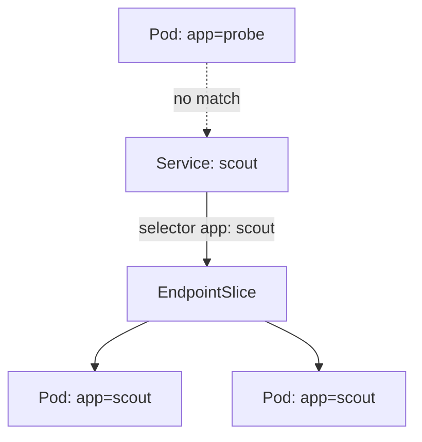

# Labels, Selectors And Ownership

A Service must keep finding the `scout` application when individual Pods are replaced. Pod names change with every replacement, so the Service cannot list them. Kubernetes solves this with labels and selectors. A separate mechanism, owner references, tells the garbage collector and the controllers which object created which. This part shows both on the playground and explains why one never replaces the other.

## Labels and selectors

A label is a key and a value attached to an object, such as `app: scout`. A selector is a rule that matches objects by their labels. A Service has a selector in its `spec`. The control plane watches the Pods that match it and keeps a list of their addresses in an EndpointSlice. Traffic sent to the Service goes to the addresses in that list.

Read the selector of the `scout` Service and the labels of the Pods:

<!-- astrona:playground:renew -->

```sh
kubectl -n starfleet get service scout -o jsonpath='{.spec.selector}{"\n"}'
kubectl -n starfleet get pods --show-labels
kubectl -n starfleet get endpointslices -l kubernetes.io/service-name=scout
```

The selector is `app: scout`. The Pod of the `scout` Deployment has the label `app=scout`, so the EndpointSlice lists its address. If a selector matches no Pod, the Service exists but has no endpoints, and requests to it fail.


The Service sends traffic only to Pods whose labels satisfy every part of the selector.

Labels are not unique. Many objects can share one label, which is how a selector chooses a group. A selector with several requirements matches an object only if all of them match. With Pods labelled `app=scout,environment=test` and `app=probe,environment=test`, the selector `app=scout,environment=test` matches one Pod, and `environment=test` matches both. A broader selector can expose a different application through the same Service.

You can test a selector on the command line before you write it into a resource:

```sh
kubectl -n starfleet get pods -l app=scout
kubectl -n starfleet get pods -l 'app in (scout,probe)'
kubectl -n starfleet get pods -l 'app,!tier'
```

The first command uses an equality requirement. The second uses a set-based requirement and matches both applications. The third matches Pods that have the key `app` and do not have the key `tier`. A label that is missing is not the same as a label with an empty value.

## Labels need a contract

The Deployment template creates the Pod labels, and the Service selector consumes them. If one side changes from `app: scout` to `application: scout` and the other does not, the link breaks even though a person recognizes the same name. Add a label to the running `scout` Pod and check the effect on selection. Save this as `label-scout-tier.yaml`, a patch that adds a label to the Deployment's Pod template:

```yaml
spec:
  template:
    metadata:
      labels:
        tier: backend
```

Apply it:

```sh
kubectl -n starfleet patch deployment scout --patch-file label-scout-tier.yaml
```

Then check the result:

```sh
kubectl -n starfleet get pods -l app=scout --show-labels
```

The Deployment controller rolls out a new ReplicaSet because the Pod template changed. The new Pod carries both labels, and the Service still selects it through `app: scout`. The old Pod is removed once the new one is ready.

## Annotations

An annotation is a key and a value that holds information for people and tools. Annotations have no selection function. They can store a contact name, a build number or the data that a tool wants to remember. The playground has a ConfigMap with an annotation:

```sh
kubectl -n starfleet get configmap crew-notes -o jsonpath='{.metadata.annotations}{"\n"}'
kubectl -n starfleet get configmap -l contact=ops
```

The first command prints the annotation. The second finds nothing, because a label selector reads labels and ignores annotations, even when an annotation has the same key as a label would have.

## Ownership

Ownership is a different relationship. An owner reference is a field in an object's metadata that names the object that manages it. A Deployment owns its ReplicaSets, and a ReplicaSet owns its Pods. The garbage collector uses owner references: when an owner is deleted, its dependents are deleted too, unless you ask to orphan them.

```sh
kubectl -n starfleet get pod -l app=scout -o jsonpath='{.items[0].metadata.ownerReferences}{"\n"}'
kubectl -n starfleet get replicaset -l app=scout -o jsonpath='{.items[0].metadata.ownerReferences[0].kind}{"\n"}'
```

The first command prints an owner reference with `kind: ReplicaSet`, the name of the ReplicaSet, a `uid` and `controller: true`. The second shows that the ReplicaSet in turn names a Deployment as its owner. Labels select which Pods a Service uses. Owner references say which controller manages a Pod and which objects disappear with their owner.

Suppose you create a bare Pod by hand with the label `app=scout`. The `scout` Service selects it, because the labels match. The Pod has no owner reference to the ReplicaSet, so the ReplicaSet does not manage it. A controller can adopt an unowned object only when its selector matches and the object has no other controller. Do not assume that a matching label means the object belongs to the controller.

## Diagnose with two questions

When traffic goes to the wrong place, compare the Service selector with the Pod labels. When objects are replaced, deleted or counted unexpectedly, read the owner references. Changing labels to fix a lifecycle problem, or changing owners to fix a routing problem, uses the wrong tool.

You now know the two relations between objects and how to read each one. Selection is a live, loose match on labels. Ownership is a stored link from an object to its manager.

## Common pitfalls

> [!WARNING]
> - **Using an annotation as a selector.** Selectors read labels only.
> - **Reading a matching label as ownership.** Owner references decide who manages and who is garbage collected.
> - **Changing one side of the label contract.** If the Pod template and the Service selector disagree, the Service has no endpoints.
> - **Forgetting that every selector requirement must match.** One extra requirement can remove all Pods from the Service.
