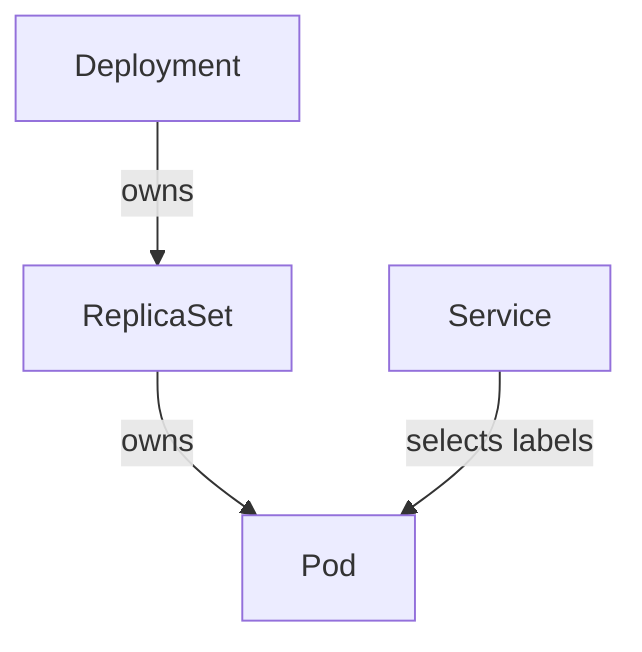

# Labels, Selectors And Ownership

A Service must keep finding the `scout` application when individual Pods are replaced. A label is a key and value attached to an object, such as `app: scout`. A selector is a rule that matches labels. The Service can select Pods carrying that label rather than listing Pod names that will soon change.

Labels can describe an application, environment or release version. They are not globally unique identifiers. Multiple objects can share the same label, which is useful for selecting a group. A selector that is too broad can include unintended Pods; one that does not match any Pod can leave a Service without backends.

Annotations are metadata for information that does not belong in selection rules. They can hold explanatory notes or tool-specific data. A Service selector uses labels, not arbitrary annotations. Giving an annotation the same spelling as a label does not make it selectable as a label.

Ownership is a different relationship. A ReplicaSet can own Pods through owner references, which identify the controlling object. A Deployment can own ReplicaSets. Kubernetes garbage collection uses these relationships when deciding what dependent objects to remove after an owner is deleted. Matching labels alone do not prove ownership.

Ownership supports lifecycle management, while the Service's selector identifies traffic backends.

Suppose two Pods carry `app: scout`, but only one belongs to the expected ReplicaSet. Both may match the Service selector even though their owners differ. Diagnose routing through the labels and selector; diagnose replica management through the controller and owner references.

## Predicting Selector Results

Imagine three Pods. Two have labels `app: scout` and `environment: test`; the third has `app: probe` and `environment: test`. A selector requiring both `app: scout` and `environment: test` matches two. A selector requiring only `environment: test` matches all three. Broadening a selector therefore can expose a different application through the same access point.

A label selector can use equality requirements or set-based requirements, depending on the resource field. Set-based expressions can require a label's value to belong to an allowed set or exclude a set. The important reasoning step is to evaluate every requirement against each candidate's actual labels. A label absent from the object is not automatically equivalent to a label with an empty value.

Labels used for selection should have a consistent naming contract between resource producers and consumers. The Deployment template creates the Pod labels, while the Service selector consumes them. If one side changes from `app: scout` to `application: scout` without the other changing, the relationship breaks even though a human recognizes the same application name.

## Ownership And Deletion Evidence

Now suppose a manually created Pod has the same labels as the managed replicas. It can match a Service selector without having the expected ReplicaSet owner reference. Whether a controller can adopt an unowned matching object depends on its rules and conditions, so labels alone cannot establish the final control relationship. Inspect the stored owner reference when explaining who currently manages the object.

Ownership is also relevant during deletion. Dependent resources can be removed through garbage collection according to the requested deletion behavior, while finalizers can delay cleanup. Selection by a Service does not create that ownership relationship. Deleting a Service therefore does not mean its previously selected Pods are automatically the Service's owned dependents.

This gives a useful diagnostic split: label evaluation explains which backends receive traffic, while identity and owner references explain which objects participate in controller lifecycle. A problem in one relationship should not be repaired by changing the other without evidence.

## Common pitfalls

> [!WARNING]
> Labels, object names and owner references answer different questions. A matching label does not establish ownership, and an annotation does not satisfy a label selector.
