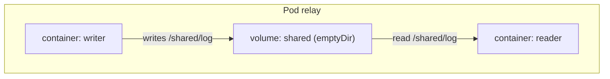

# Shared Resources And Lifecycle Evidence

When a Pod has two containers, one writes a file and the other reads it. For that to work, the two containers must see the same files, and they must be able to reach each other on the local network. This part explains what the containers of one Pod share and what they do not, then teaches how to read the three kinds of status that describe a Pod: its phase, its container states and its waiting reasons.

## What the containers of a Pod share

A Pod is a group of one or more containers that the scheduler places on one node together. The kubelet starts them with these shared resources:

- One network namespace. The Pod has one IP address, and its containers use the same ports and can reach each other on `localhost`. Two containers in one Pod cannot listen on the same port.
- The volumes that the Pod declares. Each container chooses which volumes to mount and where.
- Optionally the process namespace, when `shareProcessNamespace` is set to `true`.

The containers do not share a file system. Each container has its own root file system from its own image. A file that one container writes into its own file system is invisible to the others, unless it is written to a mounted volume.


Both containers mount the same volume, and both use the same Pod IP address.

## Try it: two containers, one volume

The playground already runs a Pod named `relay`. It has a container `writer` that appends a line to `/shared/log` every few seconds, and a container `reader` that follows the same file. Both mount an `emptyDir` volume. An `emptyDir` volume is a directory that Kubernetes creates empty when the Pod starts on a node and removes when the Pod is deleted.

<!-- astrona:playground:renew -->

```sh
kubectl -n starfleet get pod relay
kubectl -n starfleet logs relay -c reader
```

The first command shows `READY 2/2`, which means two of two containers are ready. The second prints the lines that the `reader` container reads from the file that `writer` produces. Because a Pod with more than one container needs a container name for `logs` and `exec`, the option `-c` is required.

Now prove that the root file systems are separate:

```sh
kubectl -n starfleet exec relay -c writer -- ls /shared
kubectl -n starfleet exec relay -c writer -- ls /etc/hostname
kubectl -n starfleet exec relay -c reader -- hostname
kubectl -n starfleet exec relay -c writer -- hostname
```

The `/shared` directory contains the file in both containers. The two `hostname` commands print the same name, because the containers share the network namespace and the Pod hostname. Files outside the volume belong to one container only.

## Three kinds of status

Three fields describe where a Pod is in its life, and they answer different questions. Mixing them up is the most common mistake in diagnosis.

The Pod phase is a coarse summary in `status.phase`. `Pending` means the Pod is accepted but one or more containers are not running yet: it has no node, or its images are still being pulled. `Running` means the Pod is bound to a node and at least one container is running or restarting. `Succeeded` means all containers ended with exit code 0 and will not restart. `Failed` means all containers ended and at least one failed. `Unknown` means the node cannot be reached.

The container state is more detailed, one per container, in `status.containerStatuses[].state`. It has three forms. `Waiting` means the container is not running yet and a `reason` says why. `Running` means it has started. `Terminated` means it ended and records an exit code and a reason.

A waiting reason names the cause, for example `ContainerCreating`, `ImagePullBackOff`, `ErrImagePull`, `CrashLoopBackOff` or `CreateContainerConfigError`. `CrashLoopBackOff` is not a phase. The Pod phase of a crashing Pod is still `Running`, because the kubelet keeps restarting the container.

## Read the evidence for a failing Pod

The playground Pod `crashy` exits after five seconds. Read its three kinds of status:

```sh
kubectl -n starfleet get pod crashy
kubectl -n starfleet get pod crashy -o jsonpath='{.status.phase}{"\n"}'
kubectl -n starfleet get pod crashy -o jsonpath='{.status.containerStatuses[0].state}{"\n"}{.status.containerStatuses[0].lastState}{"\n"}'
kubectl -n starfleet describe pod crashy
```

The first command shows a rising `RESTARTS` count and the status `CrashLoopBackOff` after a few restarts. The second prints the phase `Running`. The third prints the current state, usually `waiting` with the reason `CrashLoopBackOff`, and the last state, which is `terminated` with an exit code. The end of `describe` lists events from the kubelet that name each start and back-off.

Now look at the Pod `once`, which uses `restartPolicy: Never`:

```sh
kubectl -n starfleet get pod once
```

Its status is `Completed` and its phase is `Succeeded`. The container ended with exit code 0, and the kubelet did not restart it.

## Choose the evidence for the question

A question about where a Pod is placed is answered by `spec.nodeName`. A question about why a container does not run is answered by the container state and its reason, then by the events. A question about what the application printed is answered by `kubectl logs`, using `--previous` to read the logs of the last terminated container. A phase alone is never enough, because a `Running` Pod can contain a container that crashes in a loop.

You now know what the containers share and which field answers which question. The open question is what makes a container restart, what makes a Pod receive traffic, and when the Pod itself must be replaced.

## Common pitfalls

> [!WARNING]
> - **Expecting containers to share a root file system.** Only mounted volumes are shared.
> - **Calling `CrashLoopBackOff` a phase.** It is a waiting reason. The phase is still `Running`.
> - **Forgetting `-c` on a multi-container Pod.** `logs` and `exec` need a container name, or they pick a default and print a notice.
> - **Reading `Running` as healthy.** Read the container state and the ready count.
