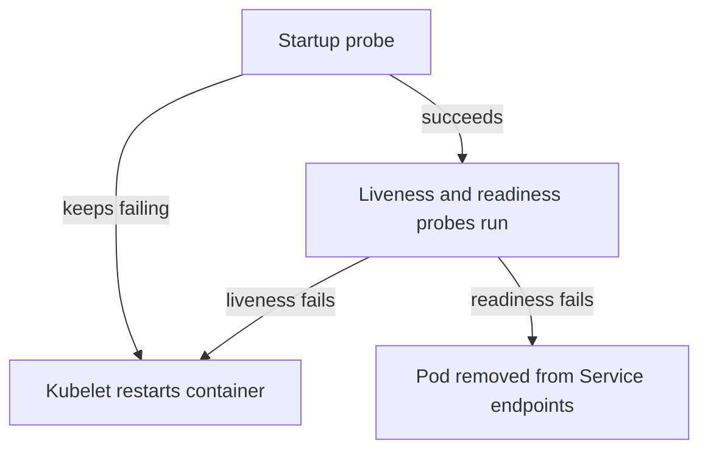

# Restart Policies, Probes And Replacement

A container can fail in three different ways. It can exit, it can run but hang, or it can run correctly but not be ready for requests yet. Kubernetes reacts differently to each one, and a different component reacts. This part explains the restart policy, the three probes and the point where restarting a container is no longer enough and a controller must replace the whole Pod.

## The restart policy

The field `spec.restartPolicy` of a Pod says what the kubelet does when a container exits. It has three values. `Always` restarts a container whenever it exits, even with exit code 0. This is the default and the value for long-running services. `OnFailure` restarts it only when the exit code is not 0. `Never` does not restart it.

The kubelet, which is the agent on the node, performs the restart. It restarts the container inside the same Pod, on the same node, with the same Pod IP address and the same volumes. After repeated failures it waits longer between restarts, with a delay that grows up to five minutes. That wait is the waiting reason `CrashLoopBackOff`. The `RESTARTS` column counts the restarts.

A restart is not a new Pod. The Pod keeps its name and its `uid`. Data in an `emptyDir` volume survives a container restart, because the volume belongs to the Pod. The container's own file system does not survive, because a restart starts from the image again.

## Probes

A probe is a check that the kubelet runs against a container. Each probe can use an HTTP request (`httpGet`), a TCP connection (`tcpSocket`), a command in the container (`exec`) or a gRPC call. Three probes exist, and each one triggers a different action:

- The startup probe asks whether the application has finished starting. While it has not succeeded, the kubelet does not run the other two probes. If it keeps failing, the kubelet kills the container and applies the restart policy. It protects slow-starting applications.
- The liveness probe asks whether the container is still working. If it fails often enough, the kubelet restarts the container.
- The readiness probe asks whether the container can receive requests now. If it fails, the container is not restarted. The Pod is marked not ready, and its address is removed from the endpoints of its Services until the probe succeeds again.


Liveness leads to a restart, and readiness leads to removal from traffic. The two are different actions.

Each probe has timing fields: `initialDelaySeconds`, `periodSeconds`, `timeoutSeconds`, `successThreshold` and `failureThreshold`. A probe must fail `failureThreshold` times in a row before the kubelet acts. A liveness probe that is stricter than the application's real behavior causes restarts that make an overloaded application worse.

## Try it: a Deployment with all three probes

Save this as `deployment-beacon.yaml`. The container image `podinfo` serves `/healthz` and `/readyz` on port 9898:

```yaml
apiVersion: apps/v1
kind: Deployment
metadata:
  name: beacon
  namespace: starfleet
spec:
  replicas: 2
  selector:
    matchLabels:
      app: beacon
  template:
    metadata:
      labels:
        app: beacon
    spec:
      containers:
        - name: beacon
          image: ghcr.io/stefanprodan/podinfo:6.15.0
          ports:
            - name: http
              containerPort: 9898
          startupProbe:
            httpGet:
              path: /healthz
              port: http
            failureThreshold: 30
            periodSeconds: 2
          livenessProbe:
            httpGet:
              path: /healthz
              port: http
            periodSeconds: 10
          readinessProbe:
            httpGet:
              path: /readyz
              port: http
            periodSeconds: 5
```

<!-- astrona:playground:renew -->

Apply it:

```sh
kubectl apply -f deployment-beacon.yaml
```

Then check the result:

```sh
kubectl -n starfleet rollout status deployment beacon
kubectl -n starfleet get pods -l app=beacon
kubectl -n starfleet describe pod -l app=beacon | grep -E 'Liveness|Readiness|Startup'
```

The `describe` output lists the three probes with their paths and timings. The Pods become `READY 1/1` only after the readiness probe succeeds.

## Break the liveness probe and read the result

Change the liveness path to one that does not exist and watch the kubelet react:

```sh
kubectl -n starfleet patch deployment beacon --type=json -p '[{"op":"replace","path":"/spec/template/spec/containers/0/livenessProbe/httpGet/path","value":"/nope"}]'
kubectl -n starfleet get pods -l app=beacon -w
```

The patch changes the Pod template, so the Deployment controller replaces the Pods. The new Pods start and become ready, then the `RESTARTS` count rises after the liveness probe fails three times (`failureThreshold` defaults to 3). Stop the watch with Ctrl+C. The event `Liveness probe failed` appears in `kubectl describe pod` together with `Container beacon failed liveness probe, will be restarted`. The restarted Pod keeps its name.

## Restart versus replacement

The kubelet restarts containers. It never creates a new Pod. A Pod that is deleted, evicted from a node or lost with its node is gone for good. A controller that owns the Pod, such as the ReplicaSet behind a Deployment, notices that fewer Pods exist than requested and creates a new Pod object. The scheduler places it, possibly on another node, and the new Pod has a new name, a new `uid` and a new IP address. A bare Pod that no controller owns is not replaced.

The failure evidence tells you which case you are in. A rising `RESTARTS` count with the same Pod name is a restart by the kubelet. A new Pod name with a recent age and `RESTARTS` of 0 is a replacement by a controller.

You now know how the kubelet reacts to a failed container and a failed check, and when a controller steps in. A Pod in the state `Running` with a failing readiness probe is alive but receives no traffic. A Pod in a restart loop is receiving the same recovery over and over, and only a change to the specification ends it.

## Common pitfalls

> [!WARNING]
> - **Expecting a readiness failure to restart the container.** Only the liveness probe and the startup probe restart it. Readiness only removes the Pod from the endpoints.
> - **Using the same strict check for liveness and readiness.** A slow dependency can make the liveness probe fail and restart a healthy process.
> - **Skipping the startup probe for a slow application.** The liveness probe can kill the container before it finishes starting.
> - **Expecting a bare Pod to come back.** Only a controller creates a replacement.
