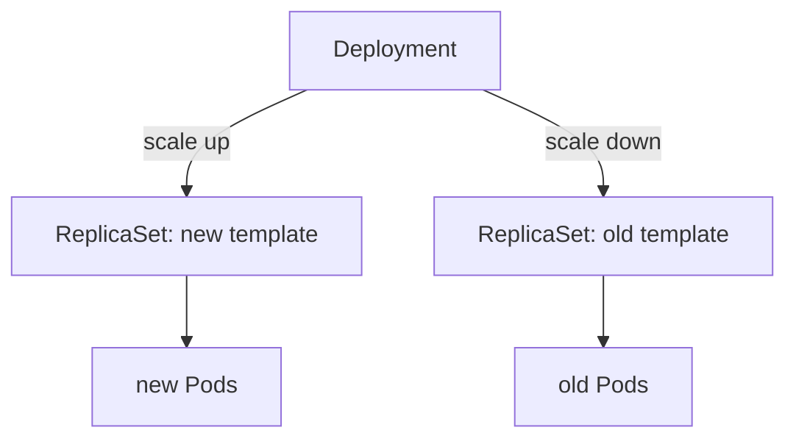

# Managing Long-Running Workloads

A web service must stay up. A new version must replace the old one without a gap. A logging agent must run on every node. A database needs replicas that keep their names and their disks. Kubernetes has a workload resource for each pattern. This part explains Deployments and ReplicaSets, how a rolling update works, and how StatefulSets and DaemonSets differ.

## Deployment and ReplicaSet

A ReplicaSet is a controller resource that keeps a set number of identical Pods running. It selects its Pods with a label selector and creates Pods from a Pod template. A Deployment is a resource one level above. It manages ReplicaSets, one for each version of the Pod template, and it adds rolling updates and rollbacks. You normally create a Deployment, and the Deployment creates the ReplicaSet.

Look at the chain for `scout` on the playground:

<!-- astrona:playground:renew -->

```sh
kubectl -n starfleet get deployment,replicaset,pod -l app=scout
kubectl -n starfleet get replicaset -l app=scout -o jsonpath='{.items[0].metadata.ownerReferences[0].kind}{"\n"}'
```

You see one Deployment, one ReplicaSet whose name is the Deployment name plus a hash of the Pod template, and one Pod named after the ReplicaSet. The owner reference of the ReplicaSet names the Deployment.

## A rolling update

A change to the Pod template, such as a new image, creates a new ReplicaSet. The Deployment controller then moves Pods from the old ReplicaSet to the new one in small steps. Two fields in `spec.strategy.rollingUpdate` set the step size. `maxSurge` is how many Pods above the desired count may exist during the update. `maxUnavailable` is how many Pods may be unavailable. Both accept a number or a percentage, and the default for each is 25%.


The Deployment scales the new ReplicaSet up and the old one down. The old ReplicaSet stays with zero Pods so that a rollback is possible.

Start an update and watch it. Scale `scout` to three replicas, then set an environment variable on its container. Any change to the Pod template starts a rollout, and an environment variable is the smallest change to make:

```sh
kubectl -n starfleet scale deployment scout --replicas=3
kubectl -n starfleet set env deployment/scout RELEASE=2
kubectl -n starfleet rollout status deployment scout
kubectl -n starfleet get replicaset -l app=scout
```

The `rollout status` command waits until the update is complete. The last command lists two ReplicaSets: the new one with three Pods and the old one with zero. Each rollout is a revision of the Deployment.

Now undo it:

```sh
kubectl -n starfleet rollout history deployment scout
kubectl -n starfleet rollout undo deployment scout
kubectl -n starfleet rollout status deployment scout
```

The history lists the revisions. The undo scales the previous ReplicaSet back up. A rollback is another rolling update in the other direction. It does not restore data that the application changed.

If the new Pods never become ready, the rollout stops. The Deployment keeps the old Pods that still serve, because `maxUnavailable` limits how many may be removed. The condition `Progressing` on the Deployment eventually reports `ProgressDeadlineExceeded`.

## StatefulSet

A StatefulSet is a workload resource for applications that need a stable identity. Its Pods get ordered names, `name-0`, `name-1` and so on, that do not change when a Pod is replaced. Each Pod can have its own PersistentVolumeClaim, created from a template, which stays attached to the same ordinal after a replacement. A StatefulSet needs a headless Service, a Service with `clusterIP: None`, so that each Pod has a stable DNS name. By default it creates Pods one at a time in order and deletes them in reverse order.

Save this as `statefulset-ledger.yaml`:

```yaml
apiVersion: v1
kind: Service
metadata:
  name: ledger
  namespace: starfleet
spec:
  clusterIP: None
  selector:
    app: ledger
  ports:
    - name: http
      port: 80
---
apiVersion: apps/v1
kind: StatefulSet
metadata:
  name: ledger
  namespace: starfleet
spec:
  serviceName: ledger
  replicas: 2
  selector:
    matchLabels:
      app: ledger
  template:
    metadata:
      labels:
        app: ledger
    spec:
      containers:
        - name: ledger
          image: busybox:1.37.0
          command: ["sh", "-c", "sleep 3600"]
```

Apply it:

```sh
kubectl apply -f statefulset-ledger.yaml
```

Then check the result:

```sh
kubectl -n starfleet get pods -l app=ledger
kubectl -n starfleet delete pod ledger-0
kubectl -n starfleet get pods -l app=ledger
```

The Pods are named `ledger-0` and `ledger-1`. After you delete `ledger-0`, the StatefulSet controller creates a Pod with the same name `ledger-0`. A Deployment would create a Pod with a new random name. This stable identity is the difference.

## DaemonSet

A DaemonSet runs one Pod on each node that matches it, or on every node. When a node joins the cluster, the DaemonSet controller adds a Pod there. When a node is removed, the Pod is garbage collected. Use it for node-level agents such as log collectors and network plugins. It has no replica count. The controller creates one Pod for each eligible node and pins it to that node. The default scheduler then binds the Pod, and the node must still satisfy the Pod's taints and tolerations.

The playground already has a DaemonSet in `kube-system`:

```sh
kubectl -n kube-system get daemonset
```

`kube-proxy` shows desired, current and ready counts equal to the number of nodes, which is two. Application DaemonSets that do not tolerate the control plane taint run only on the worker node.

## Choose by requirement

Use a Deployment for stateless replicas that are interchangeable and updated by rolling update. Use a StatefulSet when each replica needs a stable name and its own storage, or when start order matters. Use a DaemonSet when one copy must run on each node.

You now know how the long-running controllers differ and how a rolling update uses ReplicaSets. The remaining need is work that must finish and then stop.

## Common pitfalls

> [!WARNING]
> - **Creating a ReplicaSet by hand to get updates.** Only a Deployment performs rolling updates and rollbacks.
> - **Expecting a rollback to undo data changes.** It restores the Pod template only.
> - **Using a Deployment for a database that needs stable names and disks.** Use a StatefulSet.
> - **Setting `maxUnavailable: 0` and `maxSurge: 0` together.** The update cannot make progress, and the API server rejects it.
