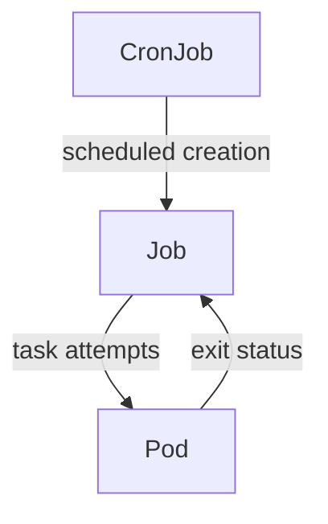

# Completion Tasks And Scheduled Tasks

The `probe` application must process a finite input and then stop. A Job manages Pods for work that should reach successful completion. Unlike a web server controller, it records completion rather than keeping an application running forever. A Job can retry failed attempts according to its configuration.

A CronJob creates Jobs according to a schedule. The schedule controls when new Jobs are requested; each Job then manages its task Pods. A nightly report fits a CronJob, while a one-time data conversion fits a Job. The CronJob is not the process that performs the report itself.

The schedule creates a Job, and the Job tracks the outcome of its Pod attempts.

Retries create an important application requirement: the same logical work may run more than once. An idempotent operation can be repeated without producing additional unwanted effects. A task can use a durable record or a unique request identifier to avoid duplicate reports or transactions. Successful Pod termination alone does not prove that an external transaction happened only once.

CronJob concurrency policies determine how overlapping executions are treated. Allow permits overlap, Forbid skips a new execution while the previous one remains active, and Replace replaces the active execution with a new one. Timing, missed schedules and controller interruptions can affect execution, so scheduled work should tolerate delay and repetition.

Compare the desired outcome in a question. If the application must keep serving requests, a Job is a poor fit. If it must finish and exit, a Deployment may repeatedly restart it. If a finite task must be requested periodically, choose a CronJob and reason separately about each Job's completion.

## Retries And Application Effects

A Job attempts a report operation. The worker writes its report to external storage, but it loses communication before recording successful completion. Another attempt can run. From Kubernetes' viewpoint, retrying unfinished work may be correct; from the business viewpoint, writing a duplicate report may be unwanted. The task needs a stable work identifier or another mechanism that makes repetition safe.

Parallelism and completion counts describe how many task attempts can run together and how many successful completions are required. They do not automatically partition the application's input or coordinate access to shared records. A worker queue, indexed input or other application contract must assign meaningful work to each attempt.

A retry limit can eventually mark a Job failed instead of retrying indefinitely. A timeout can bound execution duration. These limits help control resource consumption, but they do not identify the underlying error. A finite task that always uses invalid credentials remains broken no matter how many attempts the controller permits.

## Scheduled Overlap And Delay

Suppose a report is scheduled every hour but sometimes takes ninety minutes. Allow concurrency can produce overlapping Jobs. Forbid avoids starting a new scheduled Job while the previous one remains active; it does not pause time or guarantee a report for every intended hour. Replace asks the controller to replace an active execution, which can interrupt work and requires safe cancellation and repetition.

A schedule also depends on its configured time interpretation and controller availability. Missed start deadlines can cause a scheduled execution to be skipped rather than created indefinitely late. These conditions are reasons to design tasks around explicit data intervals and recoverable progress instead of assuming every requested wall-clock instant produces exactly one completed business result.

The robust question is what constitutes completed work and how the system recognizes it after interruption. A successful process exit is useful evidence, but durable application records must establish the intended external result. Schedule, retry and concurrency policy should then support that contract.

## Common pitfalls

> [!WARNING]
> A CronJob schedule is not an exactly-once execution guarantee. Make repeated or delayed task execution safe for the application's external effects.
