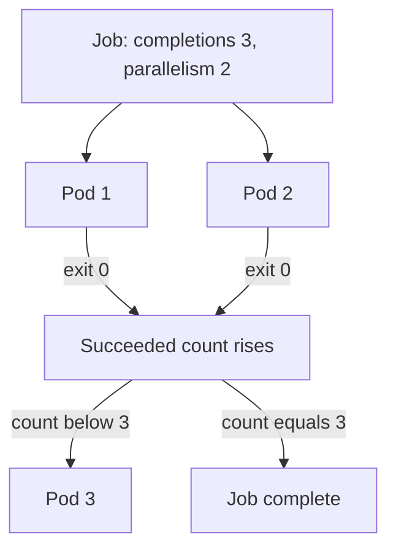

# Completion Tasks And Scheduled Tasks

A report must be generated once. A database migration must run to the end and then stop. A cleanup must run every night. A Deployment is the wrong tool for these, because it restarts a container that exits, and a finished task should not restart. Kubernetes has two resources for this work: the Job for a task that runs to completion, and the CronJob for a task that runs on a schedule. This part explains how each one works and which problems a controller does not solve for you.

## Job

A Job is a workload resource that creates Pods and keeps retrying them until a set number of them finish successfully. After that the Job is complete and creates no more Pods. A container in a Job Pod must exit for the Job to make progress. The exit code decides the result: code 0 is success, any other code is failure.

Three fields shape a Job:

- `completions` is how many Pods must succeed. The default is 1.
- `parallelism` is how many Pods may run at the same time. The default is 1.
- `backoffLimit` is how many retries the Job allows before it is marked failed. The default is 6. The delay between retries grows each time.

The Pod template of a Job must use `restartPolicy: OnFailure` or `restartPolicy: Never`. The value `Always` is rejected, because a container that always restarts could never finish. With `OnFailure` the kubelet restarts the failed container inside the same Pod. With `Never` the Job controller creates a new Pod for each retry, and the failed Pods stay for inspection.

Save this as `job-tally.yaml`:

```yaml
apiVersion: batch/v1
kind: Job
metadata:
  name: tally
  namespace: starfleet
spec:
  completions: 3
  parallelism: 2
  backoffLimit: 2
  ttlSecondsAfterFinished: 600
  template:
    spec:
      restartPolicy: Never
      containers:
        - name: tally
          image: busybox:1.37.0
          command: ["sh", "-c", "echo counting; sleep 5"]
```

Apply it:

<!-- astrona:playground:renew -->

```sh
kubectl apply -f job-tally.yaml
```

Then check the result:

```sh
kubectl -n starfleet get job tally
kubectl -n starfleet get pods -l job-name=tally
kubectl -n starfleet wait --for=condition=Complete job/tally --timeout=120s
```

The Job starts two Pods at once because `parallelism` is 2. When one finishes, the controller starts a third, because three successes are required. The Job reports `3/3` completions at the end. The Pods stay in the `Completed` state so that you can read their logs. The field `ttlSecondsAfterFinished` tells a controller to delete the Job and its Pods ten minutes after it finishes. Without it, finished Jobs stay until someone deletes them.


The Job controller counts successful Pods and creates new ones until the count equals `completions`.

## How a Job fails

A Job fails when the number of failed Pods passes `backoffLimit`, or when `activeDeadlineSeconds` is exceeded. The deadline counts from the start of the Job and covers all retries. When either happens, the controller stops the running Pods and sets the condition `Failed` on the Job. The reason is `BackoffLimitExceeded` or `DeadlineExceeded`.

A Job gives at-least-once execution. In rare cases, such as a node failure at the wrong moment, two Pods can run the same work. The task itself must tolerate that: it should be idempotent, which means that running it twice produces the same result as running it once.

## CronJob

A CronJob is a workload resource that creates a Job on a repeating schedule. It does not run containers itself. At each scheduled time the CronJob controller creates a Job from the `jobTemplate`, and the Job creates the Pods. The schedule uses the standard five-field cron format: minute, hour, day of month, month and day of week. The schedule `*/5 * * * *` means every five minutes. By default the time zone is the one of the controller manager. The field `timeZone` sets another one.

Save this as `cronjob-pulse.yaml`:

```yaml
apiVersion: batch/v1
kind: CronJob
metadata:
  name: pulse
  namespace: starfleet
spec:
  schedule: "*/5 * * * *"
  concurrencyPolicy: Forbid
  startingDeadlineSeconds: 120
  successfulJobsHistoryLimit: 2
  failedJobsHistoryLimit: 1
  jobTemplate:
    spec:
      backoffLimit: 1
      template:
        spec:
          restartPolicy: Never
          containers:
            - name: pulse
              image: busybox:1.37.0
              command: ["sh", "-c", "date; echo pulse sent"]
```

Apply it:

```sh
kubectl apply -f cronjob-pulse.yaml
```

Then check the result, and start one run now instead of waiting for the schedule:

```sh
kubectl -n starfleet get cronjob pulse
kubectl -n starfleet create job pulse-manual --from=cronjob/pulse
kubectl -n starfleet get jobs
```

The CronJob lists its schedule and the time of the last run. The `create job --from` command builds a Job from the same template without changing the schedule. Three fields control the edge cases:

- `concurrencyPolicy` decides what happens when the previous Job still runs. `Allow` starts another one, `Forbid` skips the new run, and `Replace` stops the old Job and starts a new one.
- `startingDeadlineSeconds` is how late a run may start. A run that cannot start in time counts as missed.
- The two history limits say how many finished Jobs the CronJob keeps. The defaults are 3 successful and 1 failed.

Setting `spec.suspend: true` pauses new runs without deleting the CronJob. Running Jobs are not affected.

## What controllers do not do

A controller keeps the objects in the shape you declared. It does not understand your application. A Deployment replaces a crashed Pod but cannot repair a corrupted database. A StatefulSet keeps a disk attached to `ledger-0` but does not replicate the data between replicas. A Job retries a failed container but cannot know whether the first attempt had changed some data. A CronJob can miss a run when the controller is down for longer than the starting deadline, and under `Allow` it can overlap two runs.

The application therefore still needs readiness checks that tell the truth, idempotent tasks, safe shutdown on `SIGTERM`, and its own replication for stored data. The controller provides the repeat and replace loop. The design of the workload decides whether that loop is safe.

You now know how to pick a controller and what each one promises.

## Common pitfalls

> [!WARNING]
> - **Using `restartPolicy: Always` in a Job template.** The API server rejects it. Use `OnFailure` or `Never`.
> - **Writing a task that is not safe to run twice.** A Job can run the same work more than once.
> - **Leaving `concurrencyPolicy` at `Allow` for a slow task.** Runs pile up when a run takes longer than the interval.
> - **Expecting a CronJob to run missed schedules without limit.** A run that misses its starting deadline is skipped, not delayed.
