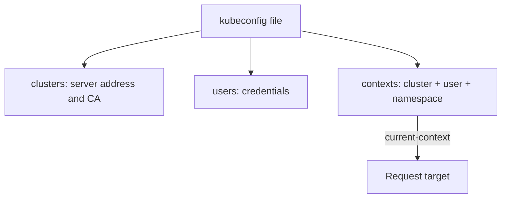

# Contexts And Reading Cluster Evidence

An administrator has access to a development cluster and a production cluster. A Deployment named `scout` exists in both. Before running any command, the administrator must know which cluster the command will reach and which identity it will use. This part explains the kubeconfig file that holds that information and the commands that show what is happening to a resource.

## The kubeconfig file

A kubeconfig is a file, by default `~/.kube/config`, that tells `kubectl` how to reach clusters. It has three lists. The `clusters` list holds the address of each API server and the certificate authority that signs its certificate. The `users` list holds credentials: a client certificate, a token or a command that fetches a token. The `contexts` list ties one cluster, one user and an optional default namespace into a named entry. The field `current-context` names the entry that `kubectl` uses now.


A context only selects an entry. The API server decides separately whether that identity may do what the request asks.

Switching the context does not move workloads and does not change permissions. It changes where the next command goes. The environment variable `KUBECONFIG` can name several files, and `kubectl` merges them.

Read your own configuration on the playground:

<!-- astrona:playground:renew -->

```sh
kubectl config current-context
kubectl config get-contexts
kubectl config view --minify
```

The first command prints the active context. The second lists every context and marks the active one with a star. The third prints only the active context, with its cluster and user. The credential data is hidden by default.

## Namespaces scope requests

A namespace is a named scope for most resources. Names must be unique inside a namespace, not across the cluster. A request without a namespace goes to the namespace set in the context, or to `default` when the context sets none. Some resources are cluster-scoped and have no namespace, for example nodes and namespaces themselves.

Set a default namespace for the context, then compare:

```sh
kubectl config set-context --current --namespace=starfleet
kubectl get pods
kubectl -n outpost get pods
kubectl get pods -A
```

The first listing shows the Pods in `starfleet`. The `-n` flag overrides the default for one command. The `-A` flag lists across all namespaces and needs permission to list in all of them. A namespace is not a security boundary by itself. Access control rules do that work.

## Choose the evidence for the symptom

Four kinds of evidence answer four different questions:

- A list (`kubectl get`) shows which objects exist and their summary state.
- A description (`kubectl describe`) combines the main fields, the conditions and the recent events of one object.
- Events (`kubectl get events`) are records that components wrote, such as a failed image pull or a failed scheduling attempt. They are kept for a limited time, by default one hour.
- Logs (`kubectl logs`) are what the container process wrote to its standard output and error streams.

Match the evidence to the stage of the Pod. A Pod with no node has no logs, so read the events. A Pod whose image cannot be pulled has no logs either, and the waiting reason tells the cause. A Pod that runs and returns errors has logs. A container that restarted keeps the logs of the previous run, which you read with `kubectl logs --previous`.

The playground has a Deployment named `broken-image` that cannot start. Look at it from three sides:

```sh
kubectl -n starfleet get pods -l app=broken-image
kubectl -n starfleet describe pod -l app=broken-image
kubectl -n starfleet get events --field-selector type=Warning
```

The list shows the status `ErrImagePull` or `ImagePullBackOff`. The description shows the same reason in the container state and the full image name in the events. The Warning events say that the pull failed. There is nothing to read with `logs`, because no container ever ran.

## Read the whole object

A summary column can hide the cause. `kubectl get -o yaml` prints the full object, with `spec` for what was requested and `status` for what was observed. The `-o jsonpath` output selects one field, and `-o custom-columns` builds a table from fields. The command `kubectl explain` documents a field from the API schema, for example `kubectl explain pod.spec.containers.resources`.

Use these to compare the requested and the observed state:

```sh
kubectl -n starfleet get deployment scout -o jsonpath='{.spec.replicas} {.status.readyReplicas}{"\n"}'
kubectl explain deployment.spec.strategy
```

The first command prints two numbers, the requested and the ready count. The second prints the documentation of the strategy field and its sub-fields.

You now know how to select the target and how to gather evidence in order. The next question is how to change the cluster safely once the cause is known.

## Common pitfalls

> [!WARNING]
> - **Running a command without checking the context.** The same resource name can exist in several clusters.
> - **Reading logs for a Pod that never started.** Use the description and the events.
> - **Trusting an old event.** Events expire. Compare the time of the event with the time of the incident.
> - **Treating a namespace as a permission.** It scopes names. The access rules decide who may act.
