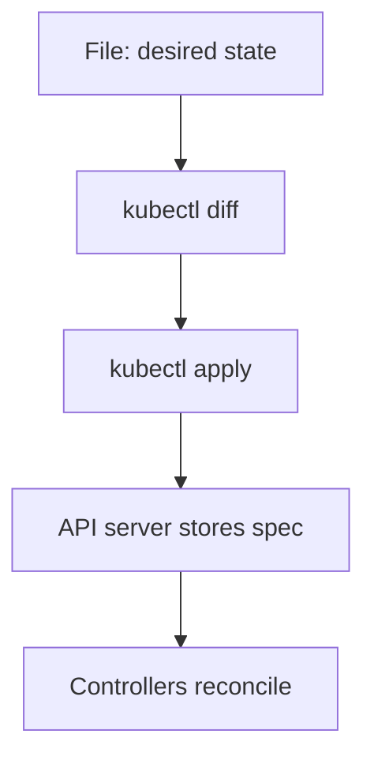

# Declarative Changes And Deletion

A team keeps the definition of `scout` in a file. A colleague changes the replica count with a command and forgets to update the file. The next time the file is applied, the colleague's change is gone, and nobody knows why. This part explains the difference between changing a cluster with commands and changing it from files, and shows what a deletion removes.

## Imperative and declarative

An imperative command tells the cluster which action to take: `kubectl create deployment`, `kubectl scale`, `kubectl delete`. The result depends on the state at the time you run it. Running `kubectl create` twice for the same name fails the second time, because the object already exists.

A declarative change gives the cluster the state you want, as a file, and lets `kubectl` work out the difference. The command is `kubectl apply -f file.yaml`. It creates the object when it does not exist and updates it when it does. It can run any number of times with the same result. A file in version control then becomes the record of what the cluster should look like.

`kubectl apply` records what you applied last. On the next apply it compares three versions: the last applied one, the live object and the new file. A field that you removed from the file is removed from the object. A field that only another actor set, such as a controller, stays. Newer clusters also support server-side apply, which tracks which actor owns each field and reports conflicts. The command is `kubectl apply --server-side`.

## Apply a file and preview a change

Save this as `deployment-bridge.yaml`:

```yaml
apiVersion: apps/v1
kind: Deployment
metadata:
  name: bridge
  namespace: starfleet
spec:
  replicas: 2
  selector:
    matchLabels:
      app: bridge
  template:
    metadata:
      labels:
        app: bridge
    spec:
      containers:
        - name: bridge
          image: ghcr.io/stefanprodan/podinfo:6.15.0
```

Apply it:

<!-- astrona:playground:renew -->

```sh
kubectl apply -f deployment-bridge.yaml
```

Then check the result:

```sh
kubectl -n starfleet get deployment bridge
```

The Deployment shows two replicas. Now edit the file and set `replicas: 3`, then preview before you apply:

```sh
kubectl diff -f deployment-bridge.yaml
kubectl apply -f deployment-bridge.yaml --dry-run=server
kubectl apply -f deployment-bridge.yaml
```

The `diff` command prints the lines that would change and changes nothing. The option `--dry-run=server` sends the request to the API server, which validates it and runs admission checks but does not store the result. The third command applies the change. The option `--dry-run=client` checks only on your machine and is weaker.


The file states the result. The controllers do the work that gets the cluster there.

## What a delete removes

`kubectl delete` removes the object you name. Objects that depend on it are removed in a second step, by the garbage collector. A dependent object has an owner reference that names its owner. A Deployment owns ReplicaSets, and a ReplicaSet owns Pods. When you delete the Deployment, the collector deletes the ReplicaSets, and then the Pods.

Three cascade modes exist. With the default `background`, the owner is deleted at once and the dependents are deleted afterwards. With `foreground`, the owner stays visible until all its dependents are gone. With `orphan`, the dependents are kept and lose their owner reference.

Try the difference on the playground:

```sh
kubectl -n starfleet delete pod -l app=bridge
kubectl -n starfleet get pods -l app=bridge
kubectl -n starfleet delete deployment bridge --cascade=orphan
kubectl -n starfleet get replicaset,pods -l app=bridge
```

Deleting the Pods of a Deployment does not remove the workload. The ReplicaSet notices the missing Pods and creates new ones, so the list shows young Pods. Deleting the Deployment with `--cascade=orphan` leaves the ReplicaSet and its Pods running with no owner. Nothing manages them any more. To remove a workload, delete its owner, not its Pods.

## Grace periods and finalizers

A deleted Pod does not vanish at once. The API server sets a deletion timestamp, and the kubelet sends `SIGTERM` to the containers. The Pod gets `terminationGracePeriodSeconds` to stop, 30 seconds by default, before the kubelet sends `SIGKILL`. A Pod in the `Terminating` state is in that window.

A finalizer is a string on an object that blocks removal until a controller has done its clean-up work and removed the string. An object with a deletion timestamp and a finalizer stays in the list as `Terminating`. Removing a finalizer by hand skips the clean-up, so it is a last resort.

You now know how to change a cluster from a file and how deletion follows ownership. Clean up the test objects:

```sh
kubectl -n starfleet delete replicaset -l app=bridge
```

## Common pitfalls

> [!WARNING]
> - **Mixing `create` and `apply` for the same object.** `apply` has no record of the object that `create` made, and the first apply can warn or conflict.
> - **Editing the live object and not the file.** The next apply from the file overwrites the edit.
> - **Deleting Pods to remove a workload.** The controller creates them again. Delete the owner.
> - **Removing a finalizer to make an object go away.** The clean-up that the finalizer protects is skipped.
