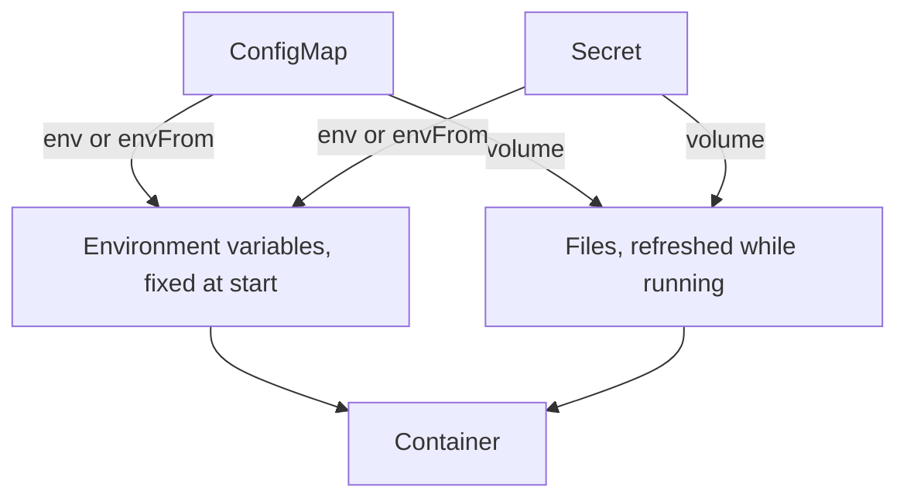

# ConfigMaps, Secrets And Configuration Delivery

A `scout` container needs a log level and an access token. The log level may be public. The token must not be. Kubernetes has one object for each case, and several ways to hand the values to a container. This part explains the two objects, the delivery methods, and which ones follow a later change.

## ConfigMap and Secret

A ConfigMap is an object that stores non-confidential configuration as key-value pairs. A value can be a short string such as `debug`, or the text of a whole file. A Secret is an object with the same shape for confidential data, such as a password, a token or a key. The two differ in handling, not in format. The API server treats Secrets with extra care: access to Secrets can be limited separately with role-based access control, and the cluster can encrypt them at rest in `etcd`.

The values in a Secret are base64 encoded. Base64 is an encoding, not encryption. Anyone who can read the Secret can decode it in one step. A Secret is protected by who may read it and by encryption at rest, not by the encoding. Both objects are limited to 1 MiB.

Create both on the playground. Save this as `settings.yaml`:

```yaml
apiVersion: v1
kind: ConfigMap
metadata:
  name: scout-settings
  namespace: starfleet
data:
  LOG_LEVEL: debug
  motd.txt: |
    Welcome aboard.
---
apiVersion: v1
kind: Secret
metadata:
  name: scout-key
  namespace: starfleet
type: Opaque
stringData:
  token: orbit-7
```

Apply it:

<!-- astrona:playground:renew -->

```sh
kubectl apply -f settings.yaml
```

Then check the result:

```sh
kubectl -n starfleet get configmap scout-settings -o yaml
kubectl -n starfleet get secret scout-key -o jsonpath='{.data.token}{"\n"}'
```

The ConfigMap shows both keys as plain text. The Secret shows the token as a base64 string, even though you wrote it with `stringData`. The field `stringData` accepts plain text and the API server stores it encoded under `data`.

## Delivery as environment variables

An environment variable is set when the container starts. The container reads the variable from its environment. Use `valueFrom` to take one key, or `envFrom` to take every key of an object.


Both objects can feed a container as variables or as files. Only the files change while the container runs.

An environment variable never changes in a running container. To see a new value, the container must restart, and in practice the Pod is replaced.

## Delivery as files

A volume of type `configMap` or `secret` mounts each key as a file in a directory. The file name is the key and the content is the value. The kubelet refreshes these files after the object changes. The refresh is not instant. It follows the kubelet sync period plus a cache delay, and it can take about a minute. The application must read the file again to notice. A file mounted with `subPath` is never refreshed.

Save this as `pod-reader.yaml`:

```yaml
apiVersion: v1
kind: Pod
metadata:
  name: reader
  namespace: starfleet
spec:
  containers:
    - name: reader
      image: busybox:1.37.0
      command: ["sh", "-c", "sleep 3600"]
      env:
        - name: LOG_LEVEL
          valueFrom:
            configMapKeyRef:
              name: scout-settings
              key: LOG_LEVEL
      volumeMounts:
        - name: settings
          mountPath: /etc/settings
        - name: key
          mountPath: /etc/key
          readOnly: true
  volumes:
    - name: settings
      configMap:
        name: scout-settings
    - name: key
      secret:
        secretName: scout-key
```

Apply it and read the values from inside the container:

```sh
kubectl apply -f pod-reader.yaml
kubectl -n starfleet wait --for=condition=Ready pod/reader --timeout=120s
kubectl -n starfleet exec reader -- sh -c 'echo $LOG_LEVEL; cat /etc/settings/motd.txt; cat /etc/key/token'
```

The container prints `debug`, the welcome line and the decoded token. Now change the ConfigMap and read again after about a minute:

```sh
kubectl -n starfleet patch configmap scout-settings --type=merge -p '{"data":{"LOG_LEVEL":"info","motd.txt":"Changed.\n"}}'
kubectl -n starfleet exec reader -- sh -c 'echo $LOG_LEVEL; cat /etc/settings/motd.txt'
```

The environment variable still shows `debug`. The file shows the new text once the kubelet has refreshed it.

## Immutable objects and a safe rollout

Setting `immutable: true` on a ConfigMap or Secret blocks all later changes to its data. The kubelet then stops watching it, which lowers the load on the API server, and nobody can break a running workload by editing it. To change the value, create a new object with a new name and point the workload at it. Pointing a Deployment at a new name changes the Pod template, so the Deployment rolls out new Pods. This is the safe way to roll out a configuration change.

You now know where configuration lives and how it reaches a container. The next question is how much of the node a container may use.

## Common pitfalls

> [!WARNING]
> - **Calling base64 encryption.** Anyone with read access to the Secret can decode it.
> - **Expecting an environment variable to change after a ConfigMap edit.** Only a new container sees the new value.
> - **Using `subPath` and expecting updates.** A `subPath` mount is never refreshed.
> - **Putting a password in a ConfigMap.** Use a Secret so that access can be limited separately.
