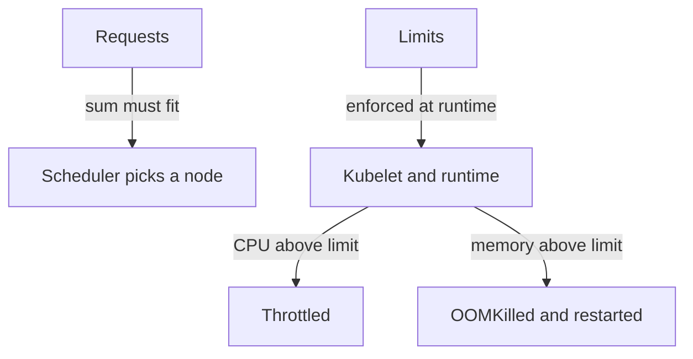

# Requests, Limits And Namespace Budgets

Two Pods share a worker node with 4 CPU cores and 8 GiB of memory. One of them has a memory leak. Without any boundary it grows until the node runs out of memory, and the kernel kills processes at random, including healthy ones. Resource settings prevent that. This part explains what a request and a limit each do, how Kubernetes ranks Pods under pressure, and how a namespace gets a budget.

## Requests and limits

A request is the amount of a resource that a container asks the scheduler to reserve. The scheduler places a Pod only on a node whose unreserved capacity covers the sum of the requests. A limit is the maximum that the kubelet and the container runtime enforce while the container runs. The two numbers answer two different questions. The request answers where the Pod fits. The limit answers how much it may use.

CPU is measured in cores, written `500m` for half a core. Memory is measured in bytes, written `128Mi`. The two resources behave differently when the limit is reached. CPU is compressible: a container above its CPU limit is slowed down, which is called throttling, and it keeps running. Memory is not compressible: a container that goes above its memory limit is killed by the kernel, and the container state shows `OOMKilled`. The kubelet then restarts it according to the restart policy.

Save this as `pod-sized.yaml`:

```yaml
apiVersion: v1
kind: Pod
metadata:
  name: sized
  namespace: starfleet
spec:
  containers:
    - name: sized
      image: busybox:1.37.0
      command: ["sh", "-c", "sleep 3600"]
      resources:
        requests:
          cpu: 100m
          memory: 64Mi
        limits:
          memory: 128Mi
```

Apply it:

<!-- astrona:playground:renew -->

```sh
kubectl apply -f pod-sized.yaml
```

Then check the result:

```sh
kubectl -n starfleet get pod sized -o jsonpath='{.status.qosClass}{"\n"}'
kubectl describe node | grep -A8 "Allocated resources"
```

The class is `Burstable`, explained below. The node description lists the total requests and limits of all Pods on the node as a share of its capacity.

## Quality of service classes

Kubernetes assigns each Pod one of three quality of service classes from its numbers. The class decides which Pods are removed first when the node runs short of memory.

- `Guaranteed`: every container has a CPU and a memory request, each equal to its limit.
- `Burstable`: at least one container has a request or a limit, but the Pod is not Guaranteed.
- `BestEffort`: no container has any request or limit.

Under memory pressure the kubelet evicts BestEffort Pods first, then Burstable Pods that use more than they requested, and Guaranteed Pods last. A Pod without a request also gets no reserved share, so it is the first to lose.


Requests are used once, at placement. Limits are enforced for as long as the container runs.

## Namespace budgets

A ResourceQuota is a namespace-level object that caps the total consumption of the namespace. It can limit the sum of requests and limits and the count of objects, such as Pods or ConfigMaps. When a request would pass the cap, the API server rejects it with a `403 Forbidden` error that names the quota. A quota that limits CPU or memory also requires every new Pod in the namespace to state that resource, or the Pod is rejected.

A LimitRange is a namespace-level object that sets defaults and bounds for each single container or Pod. It can give a default request and limit to containers that state none, and it can set a minimum and a maximum. The two objects work together: the LimitRange fills in the numbers per container, and the ResourceQuota adds them up for the namespace.

Save this as `budget.yaml`:

```yaml
apiVersion: v1
kind: ResourceQuota
metadata:
  name: counts
  namespace: outpost
spec:
  hard:
    pods: "3"
    configmaps: "5"
---
apiVersion: v1
kind: LimitRange
metadata:
  name: defaults
  namespace: outpost
spec:
  limits:
    - type: Container
      default:
        memory: 128Mi
      defaultRequest:
        memory: 64Mi
```

Apply it and read the usage:

```sh
kubectl apply -f budget.yaml
kubectl -n outpost describe resourcequota counts
kubectl -n outpost run extra --image=busybox:1.37.0 -- sleep 3600
kubectl -n outpost get pod extra -o jsonpath='{.spec.containers[0].resources}{"\n"}'
```

The description shows the used and the hard value for each line. The new Pod has no resources in its command, and the printed result shows the defaults that the LimitRange added.

You now know how the numbers drive placement, enforcement and budgets. Remove the test objects:

```sh
kubectl -n outpost delete pod extra
kubectl -n outpost delete resourcequota counts
kubectl -n outpost delete limitrange defaults
```

## Common pitfalls

> [!WARNING]
> - **Setting limits and no requests.** The request defaults to the limit, which can reserve far more than the container needs.
> - **Treating a CPU limit like a memory limit.** CPU is throttled. Memory is killed.
> - **Adding a quota on CPU or memory without a LimitRange.** New Pods that state no value are rejected.
> - **Reading node usage as reserved capacity.** The scheduler uses requests, not live usage.
