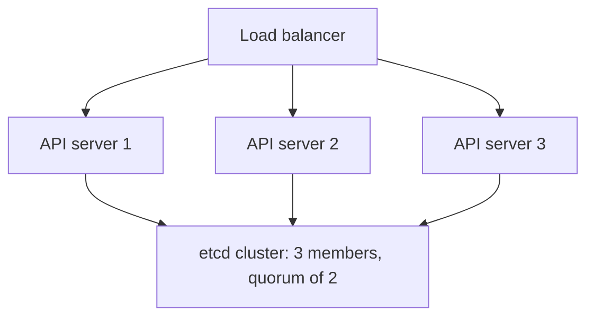

# Operating Responsibilities And Availability

A team moves its applications to Kubernetes. Six months later a new minor version is out, one node needs a kernel patch, and a disk fails on a machine that stores cluster state. Someone must handle each of these. This part explains who does what, how the control plane stays available, how its data is recovered, and how to take a node out of service without hurting an application.

## Managed and self-managed clusters

In a managed service, the provider runs the control plane: the API server, the scheduler, the controller manager and `etcd`. The provider patches and upgrades them, keeps them available and backs up `etcd`. The customer still owns the workloads, the access rules, the network policies, the resource settings and, in most services, the node pools and when they upgrade. In a self-managed cluster, the team owns everything: the machines, the certificates, the control plane, the upgrades, the backups and the monitoring.

The split matters in exam scenarios. When the question asks who must back up `etcd`, apply a node operating system patch or size the node pool, check which model it describes. The application layer is always the customer's job.

## Control plane availability

A highly available control plane runs several copies of each component. Three or five API servers sit behind a load balancer, and clients use the address of the load balancer. The scheduler and the controller manager run on every control plane node, but only one copy of each is active at a time. They use leader election through a lease object in the API, and a standby takes over when the leader stops renewing the lease.

`etcd` is different. It keeps one copy of the data on each member and uses the Raft consensus algorithm. A write is committed when a majority of members, called a quorum, accepts it. Three members tolerate the loss of one. Five members tolerate the loss of two. An even number adds cost and gives no extra tolerance, so odd sizes are used. If the quorum is lost, the cluster can no longer accept changes.


All API servers serve requests at the same time. Only `etcd` needs a quorum to commit a change.

Control plane availability is not application availability. If the control plane stops, Pods that already run keep running, because the kubelet and the container runtime on each node do not need the API server to keep a container alive. What stops is change: no new Pods, no replacement of failed Pods, no scaling and no new scheduling. The reverse also holds. A healthy control plane does not keep an application available if the application runs one replica on a node that fails.

## Recovering the datastore

`etcd` holds every object of the cluster. A backup of it is a backup of the cluster state, but not of the data in persistent volumes. The usual backup is a snapshot made with `etcdctl snapshot save`, taken on a schedule and stored outside the cluster. To recover, the team restores the snapshot into a new data directory and starts `etcd` from it. Anything created after the snapshot is lost, so the interval between snapshots sets the data loss. Managed services do this for the customer.

## Upgrades and version skew

Kubernetes publishes a new minor version, such as 1.35, about three times a year. The project supports only the most recent minor versions, so clusters must be upgraded on a regular schedule. The version skew policy sets the order. The API server is upgraded first. The controller manager and scheduler may not be newer than the API server. The kubelet may be older than the API server, by up to three minor versions, but never newer. A node upgrade is done one node at a time, with the node drained first.

## Node maintenance without downtime

Three commands take a node out of service. `kubectl cordon` marks the node unschedulable: new Pods avoid it and running Pods stay. `kubectl drain` cordons the node and then evicts the Pods, so that controllers recreate them on other nodes. `kubectl uncordon` makes the node schedulable again. Eviction respects a PodDisruptionBudget, an object that states how many Pods of an application must stay available during voluntary disruptions such as a drain.

Save this as `pdb-convoy.yaml`:

```yaml
apiVersion: policy/v1
kind: PodDisruptionBudget
metadata:
  name: convoy-budget
  namespace: starfleet
spec:
  minAvailable: 2
  selector:
    matchLabels:
      app: convoy
```

Apply it:

<!-- astrona:playground:renew -->

```sh
kubectl apply -f pdb-convoy.yaml
```

Then check the result, and take the worker node out of scheduling:

```sh
kubectl -n starfleet get pdb convoy-budget
kubectl get nodes
kubectl cordon "$(kubectl get nodes -l '!node-role.kubernetes.io/control-plane' -o jsonpath='{.items[0].metadata.name}')"
kubectl get nodes
```

The budget shows `ALLOWED DISRUPTIONS` of 1, because three Pods exist and two must stay. After the cordon, the worker node shows `SchedulingDisabled` in the status column. The Pods on it keep running. Undo it:

```sh
kubectl uncordon "$(kubectl get nodes -l '!node-role.kubernetes.io/control-plane' -o jsonpath='{.items[0].metadata.name}')"
```

A PodDisruptionBudget limits only voluntary disruptions. A node that crashes is an involuntary disruption, and no budget prevents it. The way to survive that is more replicas spread over several nodes.

You now know how responsibility, quorum, backups and maintenance fit together. Next is how the API itself can be extended.

## Common pitfalls

> [!WARNING]
> - **Assuming a managed service operates the workloads.** The provider runs the control plane. The customer runs the applications.
> - **Running two or four `etcd` members.** An even size tolerates no more failures than the odd size below it.
> - **Counting on a PodDisruptionBudget for a node crash.** It governs voluntary disruption only.
> - **Upgrading a kubelet above the API server version.** Always upgrade the API server first.
