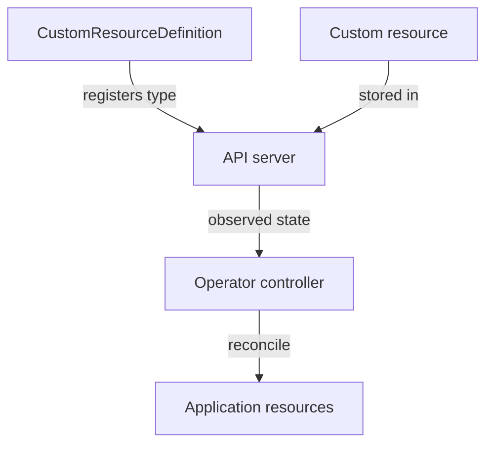

# Custom Resources And Operators

A team wants Kubernetes to manage a database using a resource named `Database`. A CustomResourceDefinition (CRD) extends the Kubernetes API with a new resource type and its schema. Creating a CRD makes that type available; it does not install database software or implement database behavior by itself.

A custom resource is an instance of the new type. It can describe a requested database version or replica count. A custom controller watches those instances and reconciles actual resources toward their requested state. An Operator is an approach that uses controllers and custom resources to encode application-specific operational knowledge.

The definition provides the API type, and the controller provides the behavior.

An Operator may automate upgrades, backups or recovery if its implementation supports them. Those capabilities are not automatic properties of every Operator. The controller needs permissions to manage the objects it creates, and its own availability and compatibility affect how reliably it can reconcile changes.

Distinguish desired-state acceptance from implemented behavior. A custom resource can exist while its controller is absent or failing. In that case, status may not progress and application objects may never appear. The API server can validate a resource schema without understanding whether an application-specific upgrade is safe.

Evaluate an extension through its API contract, controller behavior and operating requirements. For a scenario where a new resource is accepted but nothing happens, check whether a responsible controller exists and is working. For an unknown resource type, check whether the definition has been installed.

## What A Database Operator Must Implement

A custom `Database` resource might request version two, three members and a backup schedule. The CRD validates the structure of those fields. It can require an allowed version value or replica range, but schema validation alone cannot perform a safe database upgrade or verify an application-consistent backup.

The controller must translate that intent into actual operations. It might create StatefulSets, claims and Services, observe member readiness and update resource status. Application-specific logic determines upgrade order, compatibility checks and recovery actions. A controller that only creates Pods should not be assumed to implement every advanced database operation named in marketing material.

Status should provide useful evidence about that reconciliation. A condition might indicate that members are ready or that an upgrade is blocked by a compatibility check. The custom resource's generation can identify the desired revision, while the controller's observed revision indicates how far processing has reached. Creating the object and seeing a useful completed status remain separate events.

## Permissions And Controller Failure

The Operator runs as a workload or other process with credentials. It needs appropriate permissions to watch its custom resources and manage the child objects involved. Permission to create the custom resource for a user does not automatically grant its controller the permissions it needs. The identity and permissions of each participant matter.

If the controller stops, existing database processes may continue while new changes and recovery actions stall. If the CRD is missing, the API may reject the resource type before any controller can see an instance. If the controller has insufficient permissions, objects can exist without expected children being created.

Diagnose the boundary supported by evidence: type registration, accepted custom intent, controller execution, child-resource reconciliation or application health. This sequence explains both the power and limits of Operators without treating an extension as automatic operational expertise.

## Common pitfalls

> [!WARNING]
> Installing a CRD registers a resource type. The controller must be installed and functioning to turn a custom resource into application behavior.
