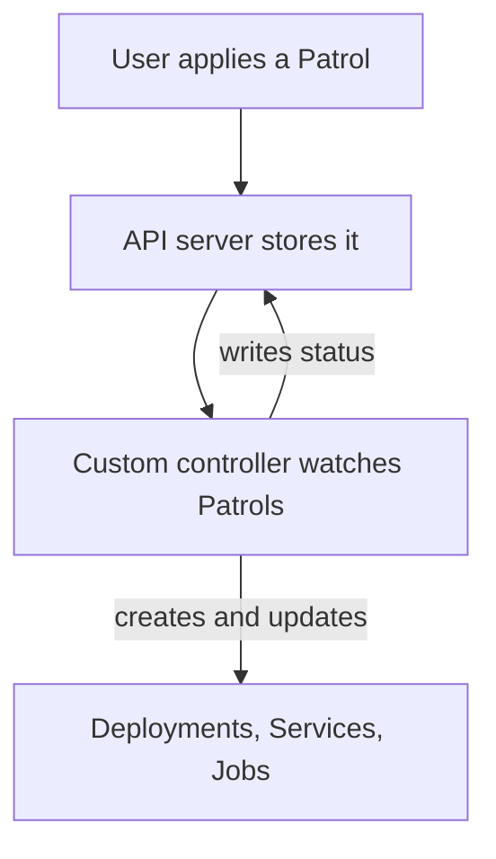

# Custom Resources And Operators

A team runs a database. Creating a replica, running a backup and promoting a standby take careful steps in a fixed order. The built-in resources do not know these steps. Kubernetes lets a team add its own resource types to the API and run a controller that acts on them. This part explains custom resources, the controller behind them and the Operator pattern.

## CustomResourceDefinition

The Kubernetes API is extensible. A CustomResourceDefinition, written CRD, is an object that registers a new resource type with the API server. After it is created, the API server serves the new type like a built-in one: it has a URL, it is stored in `etcd`, `kubectl get` lists it, and role-based access control applies to it. An object of the new type is called a custom resource. The CRD is the type, and the custom resource is the instance, in the same way that the Pod kind is the type and a single Pod is the instance.

The CRD holds an OpenAPI schema that describes the fields. The API server validates every custom resource against it and rejects one that does not match, for example a missing required field or a number below the minimum.

Save this as `crd-patrol.yaml`:

```yaml
apiVersion: apiextensions.k8s.io/v1
kind: CustomResourceDefinition
metadata:
  name: patrols.starfleet.example.com
spec:
  group: starfleet.example.com
  scope: Namespaced
  names:
    plural: patrols
    singular: patrol
    kind: Patrol
  versions:
    - name: v1
      served: true
      storage: true
      schema:
        openAPIV3Schema:
          type: object
          properties:
            spec:
              type: object
              required: ["route", "ships"]
              properties:
                route:
                  type: string
                ships:
                  type: integer
                  minimum: 1
```

Apply it:

<!-- astrona:playground:renew -->

```sh
kubectl apply -f crd-patrol.yaml
```

Then check the result:

```sh
kubectl get crd patrols.starfleet.example.com
kubectl api-resources --api-group=starfleet.example.com
kubectl explain patrol.spec
```

The API server now knows the type. The `api-resources` command lists `patrols` with the kind `Patrol`, and `explain` prints the fields from the schema.

## Create and validate a custom resource

Save this as `patrol-alpha.yaml`:

```yaml
apiVersion: starfleet.example.com/v1
kind: Patrol
metadata:
  name: alpha
  namespace: starfleet
spec:
  route: outer-ring
  ships: 2
```

Apply it, then try a version that breaks the schema:

```sh
kubectl apply -f patrol-alpha.yaml
kubectl -n starfleet get patrols
kubectl -n starfleet patch patrol alpha --type=merge -p '{"spec":{"ships":0}}'
```

The listing shows `alpha`. The patch is rejected with an error that says `ships` must be at least 1, because the schema sets `minimum: 1`. The cluster checks the object before it stores it.

A custom resource alone does nothing. It is stored data. Nothing creates a Pod or a ship because a Patrol exists, until a controller acts on it.

## Controllers and Operators

A custom controller is a program that watches objects of a type through the API and works to make the real world match them. It is the same control loop as the built-in controllers. A controller for `Patrol` would read each Patrol, create the workloads it needs and write the result into the `status` of the Patrol. It usually runs as a Deployment in the cluster.


The controller reads the custom resource and creates ordinary resources. It then reports back into the custom resource.

An Operator is a custom controller that encodes the operating knowledge of one application: install, scale, back up, upgrade and recover. A database Operator reads a `Database` custom resource and performs the ordered steps that a human administrator would perform. The user writes the desired state in one object, and the Operator keeps it true. Operators are a pattern that combines a CRD with a controller. The CRD alone is not an Operator.

## Aggregated APIs and choosing an extension

A CRD is the simplest extension, because the API server stores and serves the data. An API aggregation layer lets a separate API server handle a group of resources with its own logic. The metrics API of a cluster is served this way. Use a CRD when you need to store declarative objects, and add a controller when something must happen in response.

You now know how the API is extended. Remove the test objects:

```sh
kubectl -n starfleet delete patrol alpha
kubectl delete crd patrols.starfleet.example.com
```

Deleting a CRD deletes every custom resource of that type with it.

## Common pitfalls

> [!WARNING]
> - **Expecting a custom resource to do something by itself.** A controller must act on it.
> - **Deleting a CRD without checking the instances.** All custom resources of that type are deleted with it.
> - **Calling every CRD an Operator.** An Operator is a controller that carries application operating knowledge.
> - **Skipping the schema.** Without validation, a mistyped field is stored silently.
