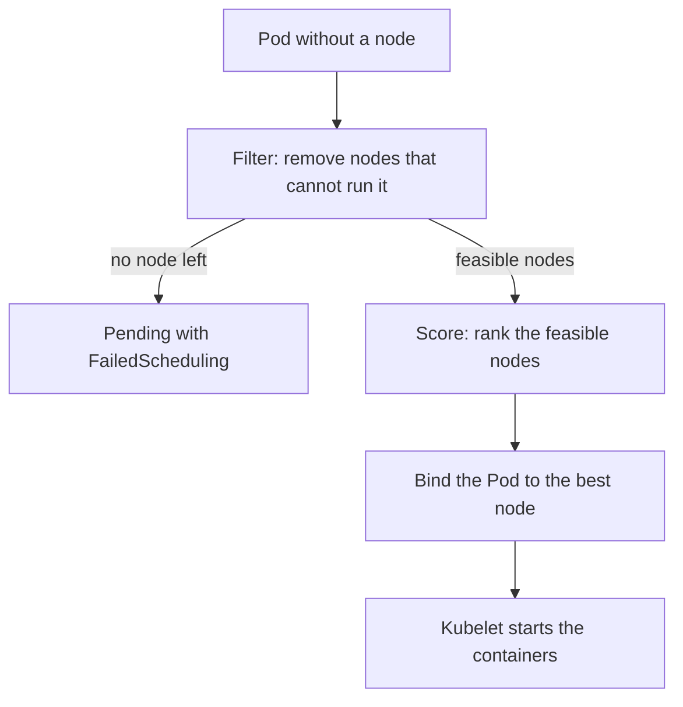

# Filtering, Scoring And Placement Rules

A new Pod for the `scout` application needs 500 millicores of CPU, a node with an SSD and, ideally, a different node from the other `scout` Pods. The scheduler turns those wishes into a decision. This part explains the two phases of that decision and the rules that influence each phase.

## Filtering and scoring

The scheduler, `kube-scheduler`, watches for Pods that have no node name. For each one it runs a cycle with two main phases. In the filtering phase it removes every node that cannot run the Pod. Reasons include too little free CPU or memory compared with the Pod's requests, a node selector that does not match, a taint that the Pod does not tolerate, or a port conflict. The nodes that remain are called feasible. In the scoring phase the scheduler ranks the feasible nodes with weighted rules, for example spreading Pods or preferring a node that already has the image. The node with the highest score wins, and ties are broken at random.

The scheduler then writes the node name into the Pod through a binding request to the API server. The kubelet on that node sees the assignment and starts the containers. If filtering leaves no node, the Pod stays `Pending`, and the scheduler records a `FailedScheduling` event that lists why each node was rejected. It retries when the cluster changes.


Filtering is a yes or no for each node. Scoring only orders the nodes that passed.

## Node selector

A node selector is the simplest rule. The field `spec.nodeSelector` lists labels that the node must have. A label is a key-value pair on an object. Nodes already carry labels such as `kubernetes.io/hostname` and `kubernetes.io/os`, and you can add your own. A Pod with a node selector is filtered out of every node that lacks all the labels.

Save this as `pod-pinned.yaml`:

```yaml
apiVersion: v1
kind: Pod
metadata:
  name: pinned
  namespace: starfleet
spec:
  nodeSelector:
    disk: ssd
  containers:
    - name: pinned
      image: busybox:1.37.0
      command: ["sh", "-c", "sleep 3600"]
```

Apply it:

<!-- astrona:playground:renew -->

```sh
kubectl apply -f pod-pinned.yaml
```

Then check the result:

```sh
kubectl -n starfleet get pod pinned
kubectl -n starfleet describe pod pinned
```

The Pod is `Pending`. The events show a `FailedScheduling` message that says no node matched the Pod's node selector. Now label one worker node and look again:

```sh
NODE="$(kubectl get nodes -l '!node-role.kubernetes.io/control-plane' -o jsonpath='{.items[0].metadata.name}')"
kubectl label nodes "$NODE" disk=ssd
kubectl -n starfleet get pod pinned -o wide
```

The scheduler retries after the label change, and the Pod starts on the labeled node. The label did not move the Pod. It made one node feasible.

## Node affinity

Node affinity does what a node selector does with more operators and a choice between hard and soft rules. The required form, `requiredDuringSchedulingIgnoredDuringExecution`, is a filter: a node that does not match is rejected. The preferred form, `preferredDuringSchedulingIgnoredDuringExecution`, is a score: each matching rule adds its weight, from 1 to 100, to the node score. A Pod can still land elsewhere. The operators include `In`, `NotIn`, `Exists`, `DoesNotExist`, `Gt` and `Lt`. The words `IgnoredDuringExecution` mean that a Pod that already runs stays when the labels of its node change later.

## Pod affinity and anti-affinity

Pod affinity and anti-affinity decide by the Pods that already run, not by node labels. Affinity attracts a Pod to the same topology domain as matching Pods. Anti-affinity repels it. A topology domain is the group of nodes that share one value of a label, named by `topologyKey`. With `kubernetes.io/hostname`, the domain is one node. With a zone label, the domain is a zone. Required anti-affinity on the hostname puts each replica on a different node, and a replica that cannot find a free node stays Pending.

Topology spread constraints solve the same need more flexibly. A constraint states `maxSkew`, the largest allowed difference in matching Pods between domains, the `topologyKey` and what to do when the rule cannot be met: `DoNotSchedule` filters, `ScheduleAnyway` only scores.

## Check what the scheduler used

Scheduling reads the request numbers, not live usage. The node view shows what the scheduler sees:

```sh
kubectl describe node "$(kubectl get nodes -l '!node-role.kubernetes.io/control-plane' -o jsonpath='{.items[0].metadata.name}')" | grep -A8 "Allocated resources"
kubectl get nodes --show-labels
```

The first command prints the sum of requests and limits as a share of the allocatable capacity. The second lists the labels that a node selector can use.

You now know how the scheduler turns rules into a node. The next question is how a node can refuse Pods that carry no rule at all.

## Common pitfalls

> [!WARNING]
> - **Expecting a node selector to create a label.** It only filters. A missing label leaves the Pod Pending.
> - **Using required anti-affinity with more replicas than nodes.** The extra replicas stay Pending.
> - **Reading `IgnoredDuringExecution` as a promise.** A running Pod is not moved when labels change.
> - **Reasoning from live usage.** The scheduler uses requests only.
