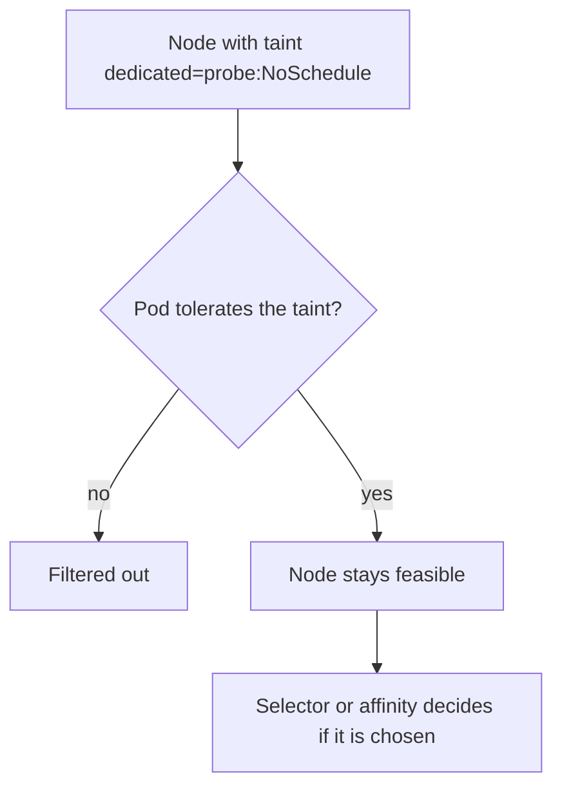

# Taints, Tolerations And Eligibility

A node with special hardware should run only the Pods that need it. A control plane node should not run ordinary application Pods. A node about to be repaired should accept nothing new. Labels and selectors attract Pods, but they cannot keep an unrelated Pod away. A taint can. This part explains taints, tolerations and the effects, and how they combine with the rules from the previous placement tools.

## Taints repel, tolerations allow

A taint is a mark on a node with a key, an optional value and an effect. It repels every Pod that does not tolerate it. A toleration is a setting on a Pod that says the Pod can accept a matching taint. The two work as a filter, not as an attraction: a toleration lets a Pod enter a tainted node, but it does not send the Pod there. To pin a Pod to a tainted node, combine the toleration with a node selector or node affinity.

The effect decides how strong the repulsion is:

- `NoSchedule`: the scheduler does not place new Pods without a matching toleration. Pods already on the node stay.
- `PreferNoSchedule`: the scheduler tries to avoid the node but may use it. It is a score, not a filter.
- `NoExecute`: new Pods are refused and running Pods without a matching toleration are evicted. A toleration can set `tolerationSeconds` to delay the eviction.

The control plane node of the playground already has a taint. Read the taints of every node:

<!-- astrona:playground:renew -->

```sh
kubectl get nodes -o custom-columns=NAME:.metadata.name,TAINTS:.spec.taints
```

The control plane node shows the taint `node-role.kubernetes.io/control-plane` with the effect `NoSchedule`. The worker nodes show none. This is why ordinary Pods do not run on the control plane node.

## Taint a node and test it

Taint one worker node, then create a Deployment that does not tolerate the taint. Save this as `deployment-patrol.yaml`:

```yaml
apiVersion: apps/v1
kind: Deployment
metadata:
  name: patrol
  namespace: starfleet
spec:
  replicas: 4
  selector:
    matchLabels:
      app: patrol
  template:
    metadata:
      labels:
        app: patrol
    spec:
      containers:
        - name: patrol
          image: ghcr.io/stefanprodan/podinfo:6.15.0
```

Taint the node and apply the file:

```sh
NODE="$(kubectl get nodes -l '!node-role.kubernetes.io/control-plane' -o name | tail -n1 | cut -d/ -f2)"
kubectl taint nodes "$NODE" dedicated=probe:NoSchedule
kubectl apply -f deployment-patrol.yaml
kubectl -n starfleet get pods -l app=patrol -o wide
```

All four Pods run on the other worker node. The tainted node and the control plane node are both filtered out. Remove the taint by repeating the key and effect with a trailing dash: `kubectl taint nodes "$NODE" dedicated=probe:NoSchedule-`.

## Write a toleration

A toleration matches a taint by key, operator, value and effect. With the operator `Equal` the key and the value must match. With `Exists` only the key must match, and the value is ignored. A toleration without a key and with `Exists` matches every taint. Save this as `deployment-escort.yaml`:

```yaml
apiVersion: apps/v1
kind: Deployment
metadata:
  name: escort
  namespace: starfleet
spec:
  replicas: 2
  selector:
    matchLabels:
      app: escort
  template:
    metadata:
      labels:
        app: escort
    spec:
      tolerations:
        - key: dedicated
          operator: Equal
          value: probe
          effect: NoSchedule
      nodeSelector:
        kubernetes.io/hostname: "NODE_NAME"
      containers:
        - name: escort
          image: ghcr.io/stefanprodan/podinfo:6.15.0
```

Replace `NODE_NAME` with the name of the tainted node, then apply it:

```sh
kubectl apply -f deployment-escort.yaml
kubectl -n starfleet get pods -l app=escort -o wide
```

Both `escort` Pods run on the tainted node. The toleration made the node feasible and the node selector chose it. Without the selector, the Pods could also run on any untainted node.


A toleration only removes a barrier. The placement rules decide whether the node is used.

## Taints that Kubernetes adds

The node controller adds taints on its own when a node has a problem. A node that stops reporting gets `node.kubernetes.io/unreachable` and one that reports memory pressure gets `node.kubernetes.io/memory-pressure`, among others. Pods get default tolerations for `not-ready` and `unreachable` with `NoExecute` and a wait of 300 seconds, so a Pod is evicted five minutes after its node is lost.

DaemonSet Pods also get tolerations for several of these taints automatically, which is why node agents keep running on troubled nodes.

You now know how nodes refuse Pods and how Pods accept the refusal. Remove the test objects:

```sh
kubectl -n starfleet delete deployment patrol escort
kubectl -n starfleet delete pod pinned
```

## Common pitfalls

> [!WARNING]
> - **Expecting a toleration to attract a Pod.** It only removes the barrier. Add a selector or affinity to choose the node.
> - **Using `NoSchedule` to clear a node.** It does not evict running Pods. Use `NoExecute` for that.
> - **Forgetting the effect in a toleration.** A toleration with no effect matches every effect for that key.
> - **Leaving a taint on after maintenance.** New Pods avoid the node and capacity quietly shrinks.
