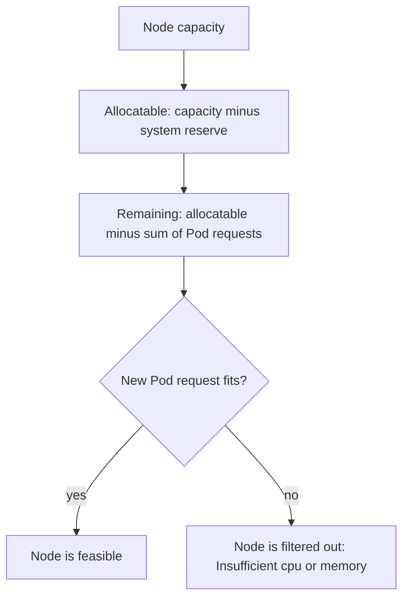

# Capacity And Pending Pods

A team scales the `scout` Deployment from 3 to 30 replicas. Ten of the new Pods start. The other twenty stay Pending, and nothing is wrong with the image or the code. The cluster has no node with enough free room. This part explains how the scheduler counts room, how to read the reason for a Pending Pod, and what can be done about it.

## Capacity, allocatable and requests

A node reports two sets of numbers. Capacity is the total CPU, memory and Pod count of the machine. Allocatable is what is left for Pods after the system reserves a part for the operating system and the Kubernetes components. The scheduler works with allocatable. It subtracts the requests of the Pods already on the node and compares what remains with the requests of the new Pod. A Pod fits when its request is at most the remaining allocatable amount for each resource.

The scheduler counts requests, not live usage. A node can be nearly idle in CPU use and still be full, because the Pods on it requested all of the CPU. A Pod with no request counts as zero for scheduling, so it always fits and can later be starved or evicted. Setting requests that match real needs is the way to make placement honest.


The remaining amount depends on requests only. Real usage does not appear in this calculation.

Read the numbers for the playground node:

<!-- astrona:playground:renew -->

```sh
kubectl get nodes -o custom-columns=NAME:.metadata.name,CPU:.status.allocatable.cpu,MEMORY:.status.allocatable.memory,PODS:.status.allocatable.pods
kubectl describe node | grep -A10 "Allocated resources"
```

The first command prints the allocatable CPU, memory and Pod count of each node. The second prints the sum of requests and limits of all Pods on the node, as an amount and as a percentage of allocatable.

## Make a Pod that cannot fit

Save this as `deployment-cargo.yaml`:

```yaml
apiVersion: apps/v1
kind: Deployment
metadata:
  name: cargo
  namespace: starfleet
spec:
  replicas: 2
  selector:
    matchLabels:
      app: cargo
  template:
    metadata:
      labels:
        app: cargo
    spec:
      containers:
        - name: cargo
          image: ghcr.io/stefanprodan/podinfo:6.15.0
          resources:
            requests:
              cpu: "100"
              memory: 64Mi
```

Apply it:

```sh
kubectl apply -f deployment-cargo.yaml
```

Then check the result:

```sh
kubectl -n starfleet get pods -l app=cargo
kubectl -n starfleet describe pod -l app=cargo
```

Both Pods are `Pending`. The events contain a `FailedScheduling` message that starts with the number of nodes in the cluster and then gives the reason for each group of nodes. The reason here is `Insufficient cpu`, because no node has 100 free cores. The Pods have no node name and no container, so `kubectl logs` has nothing to show.

## Reasons a Pod stays Pending

The scheduling message lists one reason per group of rejected nodes. The common reasons are:

- `Insufficient cpu` or `Insufficient memory`: the requests do not fit in what remains.
- `node(s) didn't match Pod's node affinity/selector`: a node selector or affinity rule rejects the node.
- `node(s) had untolerated taint`: the Pod does not tolerate a taint on the node.
- `node(s) didn't have free ports` or `Too many pods`: a host port or the Pod count limit blocks the node.
- A `PersistentVolumeClaim` that is not bound: the Pod waits for its storage.

A Pod that is rejected by a ResourceQuota is a different case. The API server refuses to create it, so no Pod object exists. A Deployment shows the refusal as an event on the ReplicaSet.

## Fix the cause

Each reason has its own remedy. Lower the request to what the container really needs. Free room by scaling down another workload. Add nodes, by hand or with a cluster autoscaler. Remove or adjust a selector, or add a toleration. The scheduler retries by itself when something changes, so a Pending Pod starts once a fix makes a node feasible.

Fix `cargo` by lowering the request, then check again:

```sh
kubectl -n starfleet patch deployment cargo --type=json -p '[{"op":"replace","path":"/spec/template/spec/containers/0/resources/requests/cpu","value":"100m"}]'
kubectl -n starfleet rollout status deployment cargo
kubectl -n starfleet get pods -l app=cargo -o wide
```

The new Pods fit and run. The change to the Pod template made the Deployment create new Pods with the smaller request.

## Priority and preemption

A PriorityClass gives Pods a number. When a high priority Pod cannot fit, the scheduler can evict lower priority Pods from a node to make room. This is called preemption. The evicted Pods go back to Pending if no other node has room. Priority does not create capacity. It only decides who gets the capacity that exists.

You now know how room is counted and how a Pending Pod is read. The next question is how the number of Pods and nodes can follow the load automatically.

```sh
kubectl -n starfleet delete deployment cargo
```

## Common pitfalls

> [!WARNING]
> - **Reading usage as free room.** The scheduler subtracts requests. An idle node can be full.
> - **Leaving requests out.** The Pod counts as zero, fits anywhere and is first to be evicted.
> - **Reading logs of a Pending Pod.** No container ran. Read the `FailedScheduling` event.
> - **Mixing up quota rejection and Pending.** A rejected Pod is never created. A Pending Pod exists and waits.
