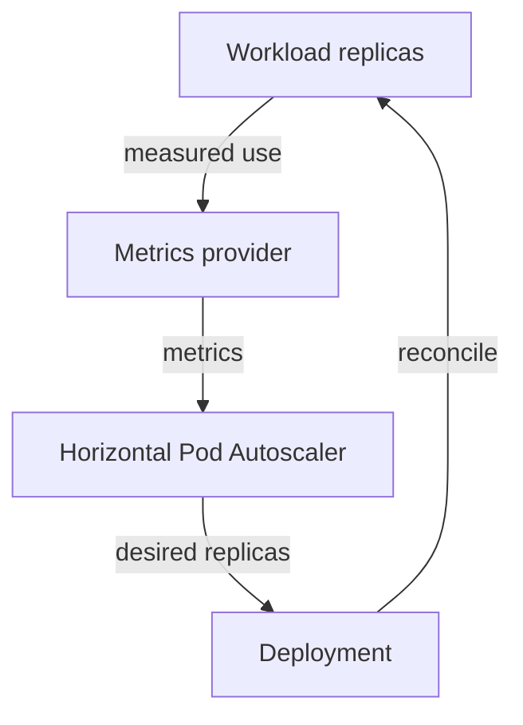

# Replica Autoscaling And Availability

Traffic to `scout` increases. Adding more application replicas can share requests if the application and its dependencies support parallel work. The Horizontal Pod Autoscaler (HPA) adjusts the replica count of a supported target according to configured metrics and a control loop.

For CPU utilization targets, utilization is measured relative to resource requests. A metrics provider supplies observations; the autoscaler compares them with its target and calculates a desired replica count within configured bounds. Missing metrics or requests can prevent the expected calculation. Scaling decisions also use timing and stabilization behavior rather than responding instantly to every fluctuation.

The feedback loop changes application replicas; it does not directly add worker nodes.

More replicas need somewhere to run. An HPA can request ten replicas while only six fit on existing nodes. Node autoscaling may then provide additional capacity, but these are separate mechanisms. Vertical sizing changes resource requests or limits for a workload rather than simply adding copies.

Availability also needs ready backends, suitable spreading and resilient dependencies. A PodDisruptionBudget limits certain voluntary disruptions according to availability requirements. It does not prevent hardware failure, guarantee capacity or replace a sound application design. A budget that cannot be satisfied may block maintenance rather than solve the missing redundancy.

For a scenario, identify whether demand exceeds application concurrency, node capacity or a dependency's capacity. Adding request handlers cannot repair a database bottleneck by itself. Scaling is effective only when the component receiving more capacity is the limiting part of the system.

## Interpreting A CPU Utilization Target

Suppose four `scout` replicas each request 200 millicores and use about 100 millicores. Their CPU utilization relative to requests is about 50%. An HPA target expressed as CPU utilization compares against that request-relative measure, not the node's total CPU percentage. Changing requests can change the calculated utilization even when measured process usage stays similar.

When observed demand rises above the target, the autoscaler can request more replicas within its configured minimum and maximum. Its decisions depend on available metrics, valid target configuration and timing rules. A momentary spike need not cause an immediate matching replica increase, and missing metrics can prevent straightforward interpretation.

Replica scaling assumes the workload can distribute useful work across more instances. A serial task, a fixed external bottleneck or a limited connection pool can undermine that assumption. More instances can even increase load on a struggling dependency. Inspect whether added capacity addresses the actual limiting component.

## Three Different Capacity Controls

Horizontal scaling changes the number of instances. Vertical sizing changes the resources assigned to each instance. Node scaling changes the pool of machines that can host them. A healthy operating model may use all three, but they have different inputs, delays and compatibility requirements.

A replica increase can encounter Pending Pods because the node pool is full. A node increase can create unused capacity if the application is still capped at a low maximum replica count. Enlarging a container request can improve its resource allocation while reducing how many replicas fit on each node.

Availability requires these controls to agree with readiness and placement. Disruption budgets can limit supported maintenance removals, but they cannot replace capacity after involuntary loss. A clear scaling explanation identifies the metric or requirement, the value being changed and the stage where the additional capacity becomes useful.

## Common pitfalls

> [!WARNING]
> The HPA changes replicas, not node count. Additional replicas can remain Pending, and a disruption budget does not prevent involuntary failures.
