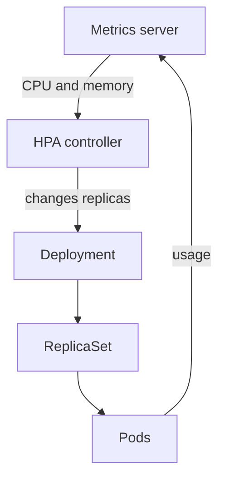

# Replica Autoscaling And Availability

Traffic to `scout` is ten times higher at noon than at night. Running the noon number of replicas all day wastes money. Running the night number all day fails at noon. Autoscaling adjusts the size of the system to the load. This part explains the three autoscalers, how the horizontal one decides, and what keeps the application available while the number of Pods changes.

## Three kinds of scaling

Horizontal scaling changes the number of Pod replicas. The HorizontalPodAutoscaler, written HPA, does this for a workload such as a Deployment. Vertical scaling changes the size of each Pod, meaning its requests and limits. The VerticalPodAutoscaler is an add-on that recommends or applies new sizes. Cluster scaling changes the number of nodes. A cluster autoscaler adds nodes when Pods are Pending for lack of room and removes nodes that stay mostly empty. The three work at different layers and can be combined: more replicas need room, and room comes from more nodes.

## How the HPA decides

The HPA is a controller that runs a loop, by default every 15 seconds. It reads a metric for the Pods of the target, compares it with the target value and computes the number of replicas it wants. For a resource metric such as CPU utilization, utilization is the usage divided by the request of the container. This is why a CPU request must exist for CPU-based scaling to work. The formula is:

```
desiredReplicas = ceil( currentReplicas * currentMetric / targetMetric )
```

With 4 replicas at 90 percent average CPU and a target of 60 percent, the HPA wants ceil(4 * 90 / 60) = 6 replicas. The result is kept between `minReplicas` and `maxReplicas`. Scale-down is slower than scale-up. A stabilization window, 300 seconds by default for scale-down, makes the HPA use the highest recommendation of the window, so short dips do not remove Pods.

The metric comes from the Metrics API. A metrics server in the cluster collects CPU and memory from the kubelets and serves them through the aggregation layer. Without it, the HPA has no data. Custom metrics need an adapter that serves them through the custom metrics API.


The HPA never creates Pods. It changes the replica count of the target, and the normal controllers do the rest.

## Create an HPA

Save this as `hpa-engine.yaml`:

```yaml
apiVersion: autoscaling/v2
kind: HorizontalPodAutoscaler
metadata:
  name: engine
  namespace: starfleet
spec:
  scaleTargetRef:
    apiVersion: apps/v1
    kind: Deployment
    name: engine
  minReplicas: 2
  maxReplicas: 6
  metrics:
    - type: Resource
      resource:
        name: cpu
        target:
          type: Utilization
          averageUtilization: 60
```

Apply it:

<!-- astrona:playground:renew -->

```sh
kubectl apply -f hpa-engine.yaml
```

Then check the result:

```sh
kubectl -n starfleet get hpa engine
kubectl -n starfleet describe hpa engine
```

The playground has no metrics server, so the target column shows `<unknown>` and the description reports that the metrics could not be read. The HPA object itself is valid and stored. This is a typical state for a new cluster: the configuration is right and the data source is missing. With a metrics server, the same object would show a percentage and would change the replica count.

## Availability while scaling

Scaling changes the number of Pods. Several mechanisms keep the application usable while that happens.

- Readiness probes keep a new Pod out of the Service endpoints until it can serve.
- A rolling update strategy with `maxUnavailable` and `maxSurge` limits how many Pods are missing during a change.
- A PodDisruptionBudget limits how many replicas voluntary disruptions, such as a node drain, may remove at once.
- Spreading replicas over nodes and zones, with anti-affinity or topology spread constraints, means that one node failure removes only some of them.
- Graceful shutdown lets a stopping Pod finish its requests: the Pod receives `SIGTERM`, is removed from the endpoints and has `terminationGracePeriodSeconds` to finish.

An autoscaler is not a substitute for these. A fast scale-up still waits for scheduling, image pulls and readiness, so the HPA reacts in minutes, not seconds. A minimum replica count that covers the base load gives the application headroom during that time.

## Choose the scaler

Use an HPA for stateless workloads whose load changes. Use a VPA when the right size of a single Pod is unknown. Do not combine an HPA and a VPA on the same CPU or memory metric, because they fight over the same signal. Use a cluster autoscaler when Pods go Pending for lack of room, and nodes can be added. Scale to zero needs an extra component, because the built-in HPA keeps at least one replica unless a feature gate is on.

You now know how scaling and availability fit together. Remove the test objects:

```sh
kubectl -n starfleet delete hpa engine
```

## Common pitfalls

> [!WARNING]
> - **Creating a CPU-based HPA for Pods without a CPU request.** Utilization is usage divided by the request, so it cannot be computed.
> - **Expecting the HPA to work without a metrics server.** The target shows `<unknown>` and nothing scales.
> - **Using an HPA and a VPA on the same metric.** They respond to each other and the replica count oscillates.
> - **Setting `minReplicas: 1` for a service that must survive a node failure.** One replica is one point of failure.
