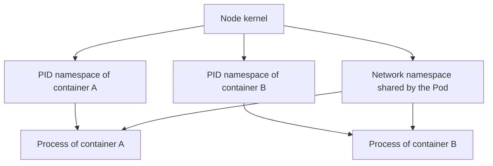

# Processes, Namespaces And Control Groups

The `scout` application runs in a Linux container. A container is a process, or a group of processes, started with isolation and resource controls. It does not have its own operating system kernel. Containers on the same node use the kernel of that node. This part explains the two kernel features that create the isolation, shows both on a running Pod, and compares the result with a virtual machine.

## Namespaces limit what a process sees

A Linux namespace gives a process its own view of one kind of system resource. The kernel supports several kinds. A process identifier (PID) namespace gives the container its own list of processes, so the main process of a container sees itself as process 1. A mount namespace gives it its own filesystem tree, built from the image and the volumes. A network namespace gives it its own interfaces, addresses and port numbers. Other kinds cover host names, inter-process communication and user identifiers.

A Linux namespace is not a Kubernetes namespace. The first is a kernel feature that isolates a process. The second is an API object that groups Kubernetes resources and scopes names and permissions. They share a word and nothing else.

Containers of one Pod share the network namespace, so they reach each other on `localhost`. By default each container has its own PID and mount namespaces. A Pod can ask for one PID namespace for all its containers with `shareProcessNamespace: true`.


Each namespace changes what a process sees. All the processes still run on one kernel.

## See the isolation

Save this as `pod-inspector.yaml`:

```yaml
apiVersion: v1
kind: Pod
metadata:
  name: inspector
  namespace: starfleet
spec:
  shareProcessNamespace: true
  containers:
    - name: app
      image: busybox:1.37.0
      command: ["sleep", "3600"]
    - name: tools
      image: busybox:1.37.0
      command: ["sleep", "3600"]
```

Apply it:

<!-- astrona:playground:renew -->

```sh
kubectl apply -f pod-inspector.yaml
kubectl -n starfleet wait --for=condition=Ready pod/inspector --timeout=120s
```

Then check the result:

```sh
kubectl -n starfleet exec inspector -c tools -- ps
```

The `ps` command lists the processes in the shared PID namespace. It shows the `sleep` process of both containers, plus the Pod pause process that holds the namespaces. Without `shareProcessNamespace`, the same command lists only the processes of its own container.

## Control groups limit what a process uses

A control group, called a cgroup, is a kernel feature that accounts for and limits the resources used by a group of processes. It controls CPU time, memory, the number of processes and other resources. The kubelet creates a cgroup for each container and sets its limits from the container `resources` field.

The two kinds of limit behave differently. A CPU limit throttles: the kernel gives the container less CPU time, and the process runs slower. A memory limit is a hard ceiling: when the container uses more memory than its limit, the kernel out-of-memory (OOM) killer ends a process, and the container shows the reason `OOMKilled`. The kubelet then restarts the container according to the Pod `restartPolicy`.

Requests and limits have different jobs. A request is used by the scheduler to place the Pod. A limit is written into the cgroup and enforced by the kernel on the node.

## Trigger a memory limit

Save this as `pod-greedy.yaml`:

```yaml
apiVersion: v1
kind: Pod
metadata:
  name: greedy
  namespace: starfleet
spec:
  containers:
    - name: greedy
      image: busybox:1.37.0
      command: ["sh", "-c", "a=$(head -c 30000000 /dev/zero | tr '\\0' x); sleep 3600"]
      resources:
        limits:
          memory: 16Mi
```

Apply it and read the status after a few seconds:

```sh
kubectl apply -f pod-greedy.yaml
kubectl -n starfleet get pod greedy
kubectl -n starfleet get pod greedy -o jsonpath='{.status.containerStatuses[0].lastState.terminated.reason}{"\n"}'
```

The Pod restarts again and again, and the last terminated state names the reason `OOMKilled` with exit code 137. The command needs more than the 16 MiB ceiling, so the kernel ends it. Raising the limit above the real need stops the kills. Removing the limit also stops them, but then the container can take the memory of the node.

## Containers compared with virtual machines

A virtual machine runs a complete guest operating system, with its own kernel, on virtual hardware that a hypervisor provides. A container shares the host kernel. This has consequences. A container starts in the time it takes to start a process and carries no guest operating system. A virtual machine has a stronger boundary, because a flaw in the shared kernel does not reach a guest that has another kernel.

The two are often combined. The nodes of a cluster can be virtual machines, and the containers on each node still share that node kernel. Sandboxed runtimes add a lightweight virtual machine or a user-space kernel around a Pod for workloads that need a stronger boundary. The design should state which boundary is in use instead of saying that something is isolated.

Isolation also depends on configuration. A privileged container, a mounted host directory or an added Linux capability weakens the boundary. Running as root inside a container is not safe only because of the image. Setting a non-root user and dropping capabilities narrows what a compromised process can do.

You now know that a container is a process whose view comes from namespaces and whose limits come from cgroups. The remaining question is which software sets them up.

```sh
kubectl -n starfleet delete pod inspector greedy
```

## Common pitfalls

> [!WARNING]
> - **Mixing up Linux namespaces and Kubernetes namespaces.** One isolates processes in the kernel. The other groups API objects.
> - **Treating a container as a small virtual machine.** Containers share the node kernel and have no kernel of their own.
> - **Expecting a CPU limit to kill a process.** CPU is throttled. Only memory over the limit causes `OOMKilled`.
> - **Assuming root in a container is harmless.** Privileges, mounts and capabilities decide how strong the boundary is.
