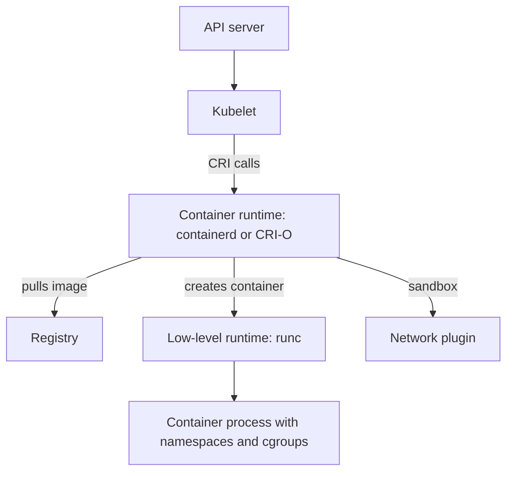

# Runtimes And Kubernetes Integration

Kubernetes does not start containers itself. The kubelet on each node asks other software to pull images and run processes. A Pod can be assigned to a healthy node and still fail to start because the software below the kubelet fails. This part names the layers between the kubelet and the container process, explains the interface and the standards that connect them, and shows how to read which runtime a node uses.

## The layers on a node

The kubelet is the node agent. It watches the API server for Pods assigned to its node and turns each Pod into requests for a container runtime. A container runtime is the software that manages images and the lifecycle of containers on a node. Containerd and CRI-O are two runtimes that Kubernetes clusters commonly use.

The kubelet and the runtime talk through the Container Runtime Interface (CRI). The CRI is a gRPC API defined by Kubernetes. It has calls to create and remove a Pod sandbox, to create, start and stop containers, and to pull and list images. Any runtime that implements the CRI can serve a kubelet. This is why a cluster can switch from one runtime to another without changing the Pods.

A runtime does not create the isolation itself. It calls a low-level runtime, most often `runc`, which creates the namespaces and cgroups and starts the process. The Pod sandbox is the shared environment of a Pod: the network namespace and the other namespaces that its containers share. A network plugin, called through the Container Network Interface, attaches that sandbox to the cluster network.


The kubelet only speaks the CRI. Everything below that line is the job of the runtime.

## Standards from the Open Container Initiative

The Open Container Initiative (OCI) defines three specifications. The image specification describes the format of an image: its layers, its configuration and its manifest. The runtime specification describes how a low-level runtime starts a container from a filesystem bundle and a configuration. The distribution specification describes how a registry serves and receives images.

The CRI and the OCI specifications are different things. The CRI is the contract between the kubelet and the runtime. The OCI specifications are the contracts for image format, container execution and registry transfer. An image built by any tool that follows the image specification can run on any runtime that follows it, so the build tool and the node runtime can be different products.

## Read the runtime of a node

Run these commands on the playground:

<!-- astrona:playground:renew -->

```sh
kubectl get nodes -o wide
kubectl get nodes -o jsonpath='{.items[0].status.nodeInfo.containerRuntimeVersion}{"\n"}'
kubectl get nodes -o jsonpath='{.items[0].status.nodeInfo.kernelVersion}{"\n"}'
```

The wide listing has a column for the container runtime. The second command prints the runtime name and version, as a value that starts with `containerd://`. The third prints the kernel version of the node. Every container on the node uses that one kernel, which ties this part back to the shared kernel.

The node also reports its operating system and architecture:

```sh
kubectl get nodes -o jsonpath='{.items[0].status.nodeInfo.architecture}{" "}{.items[0].status.nodeInfo.osImage}{"\n"}'
```

An image must offer a variant for that operating system and architecture. A valid image name does not help when the registry has no matching variant.

## Follow a Pod start

Create a Pod and watch the events:

```sh
kubectl -n starfleet run lander --image=busybox:1.37.0 --restart=Never -- sleep 3600
kubectl -n starfleet wait --for=condition=Ready pod/lander --timeout=120s
kubectl -n starfleet describe pod lander
```

The events list the sequence: the scheduler assigns the Pod, then the kubelet reports that the image is present on the machine or is pulled, and then it reports that the container was created and started. The words `Pulled`, `Created` and `Started` come from the kubelet, which reports what the runtime did.

## Why the interface exists

Before the CRI, the kubelet contained code for each runtime it supported. Every new runtime meant a change inside Kubernetes. The CRI moved that code out. The kubelet now has one client, and each runtime provides one server. A runtime vendor can release a fix without a Kubernetes release, and a cluster operator can change the runtime of a node without changing any Pod.

The interface has two services. The runtime service handles Pod sandboxes and containers: create, start, stop, remove, list and report status. The image service handles images: pull, list and remove. Both are served from one local socket on the node, which the kubelet is configured to use. If that socket does not answer, the kubelet marks the node condition `Ready` as false after a while, and the control plane stops placing new Pods there.

## Locate a failure by layer

Each layer fails in its own way. If the scheduler cannot place a Pod, the Pod has no node. If the kubelet cannot reach its runtime, containers on that node fail to create, usually for every Pod on it. If one image reference is wrong, only the Pods that use it fail, with a pull error. If the container starts and exits, execution worked, and the cause is in the application or its configuration. Naming the layer first prevents blaming the control plane for a node or image problem.

A different runtime changes nothing in the Pod specification. A runtime class can select an alternative low-level runtime, such as a sandboxed one, for chosen Pods. This needs a `RuntimeClass` object and a node that supports it.

You now know the layers from the API server down to the process, and which interface or standard governs each boundary. Remove the test Pod:

```sh
kubectl -n starfleet delete pod lander
```

## Common pitfalls

> [!WARNING]
> - **Calling the CRI an OCI specification.** The CRI is the kubelet-to-runtime interface. The OCI specifications cover images, execution and registries.
> - **Assuming the build tool must be the node runtime.** An image built with one tool runs on any compatible runtime.
> - **Blaming the scheduler for a failed start.** A Pod with a node and no running container points to the kubelet, the runtime or the image.
> - **Ignoring the architecture.** A valid image reference still fails on a node when no variant matches its architecture.
