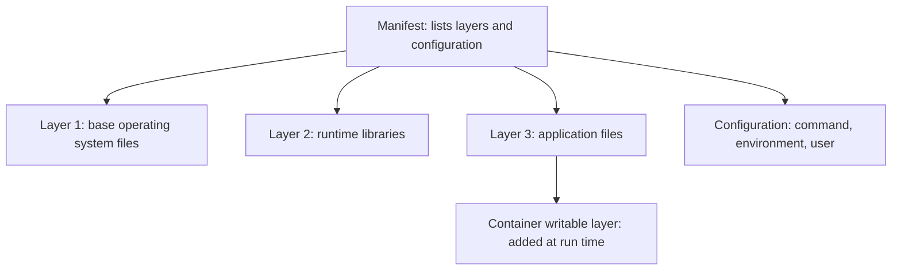

# Layers, Tags And Digests

The `scout` image contains the application files and the libraries the application needs. An image is a packaged filesystem together with the configuration that says how to run it: the default command, environment variables and the user. This part explains how an image is built from layers, what a container adds on top of them, and how a reference names an image in a way that can or cannot change over time.

## Layers

An image is a stack of layers. Each layer is an archive of filesystem changes: files added, changed or removed relative to the layer below. A manifest lists the layers and the configuration of the image. Layers are read-only and identified by a hash of their content. Two images that start from the same base share the base layers. A registry stores each layer once, and a node downloads a layer only if it does not have it already.

This reuse matters in practice. When version two of `scout` differs from version one only in the application layer, a node that has version one downloads only the new layer. A change low in the stack, such as a new base layer, changes every layer above it and forces a larger download.


The image layers are read-only. The container adds one writable layer on top.

## The writable container layer

When a container starts, the runtime adds a thin writable layer above the image layers. Files the container creates or changes go there. The image does not change, and another container started from the same image does not see those files. When the container is removed, its writable layer is removed with it.

This is why the writable layer is not storage for application data. A Pod that is replaced, rescheduled or restarted by the Deployment starts again from the unchanged image. Data that must survive belongs in a volume, which has its own lifecycle. A volume mounted over a path also hides what the image has at that path, so the files a process sees depend on both the image and the mounts.

## Prove it on the playground

Create a Pod, write a file, delete the Pod and create it again. Save this as `pod-scratch.yaml`:

```yaml
apiVersion: v1
kind: Pod
metadata:
  name: scratch
  namespace: starfleet
spec:
  containers:
    - name: scratch
      image: busybox:1.37.0
      command: ["sleep", "3600"]
```

Apply it and write a file:

<!-- astrona:playground:renew -->

```sh
kubectl apply -f pod-scratch.yaml
kubectl -n starfleet wait --for=condition=Ready pod/scratch --timeout=120s
kubectl -n starfleet exec scratch -- sh -c 'echo report > /tmp/report.txt; cat /tmp/report.txt'
```

The file is printed. Now remove the Pod, create it again and look for the file:

```sh
kubectl -n starfleet delete pod scratch
kubectl apply -f pod-scratch.yaml
kubectl -n starfleet wait --for=condition=Ready pod/scratch --timeout=120s
kubectl -n starfleet exec scratch -- ls /tmp
```

The directory is empty. The new Pod started from the image, and the file lived only in the writable layer of the old container.

## References, tags and digests

An image reference has up to four parts: a registry host, a repository path, a tag and a digest. In `ghcr.io/stefanprodan/podinfo:6.15.0` the registry is `ghcr.io`, the repository is `stefanprodan/podinfo` and the tag is `6.15.0`. When the registry is missing, the runtime uses its default registry. When the tag is missing, the tag is `latest`.

A tag is a label that a publisher attaches to an image. The publisher can move it to another image at any time, so the same tag can name different content on different days. A digest has the form `sha256:` followed by a hash of the image manifest. A digest cannot name different content, because changing the content changes the hash. A reference such as `podinfo@sha256:...` always selects the same image.

Tags are fine for human naming. Digests are the right reference when a release, a test result or an incident must tie to exact content.

## Read the digest of a running container

```sh
kubectl -n starfleet get pods -l app=scout -o jsonpath='{.items[0].spec.containers[0].image}{"\n"}'
kubectl -n starfleet get pods -l app=scout -o jsonpath='{.items[0].status.containerStatuses[0].imageID}{"\n"}'
```

The first command prints the reference from the Pod specification, which has a tag. The second prints the image identifier that the runtime resolved, which includes the digest after the `@` sign. The specification says what was asked for. The status says what is running.

## Multi-platform images

One name can cover several processor architectures. An image index is a manifest that lists one image manifest per platform. The runtime picks the entry that matches the operating system and architecture of the node. If the index has no matching entry, the pull fails even when the name, tag and credentials are correct.

Suppose a workload changes behavior after a restart while its tag stays the same. Check three things in order: whether the tag was moved to new content, whether the digest the node pulled is different, and whether mounts or settings changed. Each cause is distinct, and the digest in the Pod status shows which one applies.

```sh
kubectl -n starfleet delete pod scratch
```

## Common pitfalls

> [!WARNING]
> - **Treating a tag as immutable.** A publisher can move a tag. Only a digest names fixed content.
> - **Storing data in the container filesystem.** The writable layer disappears with the container.
> - **Forgetting the default tag.** A reference with no tag means `latest`, which changes often.
> - **Blaming credentials for a platform mismatch.** A missing platform variant fails the pull on its own.
