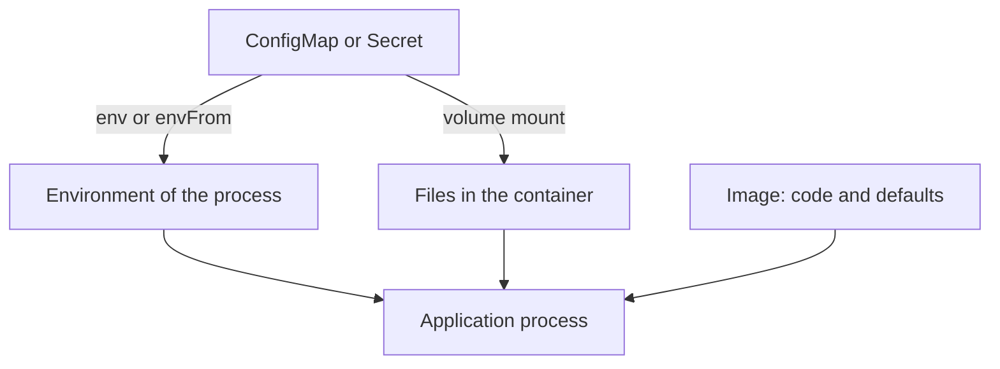

# Startup, Configuration And Application State

The `scout` container starts one process, receives its settings from outside the image and writes its files to a disposable filesystem. This part explains how Kubernetes decides what to run, how configuration reaches the process, what happens to the state it writes and how the process is stopped. Each of these has a rule that surprises people who are used to servers.

## The start command

An image has a default command, set when the image was built. Docker names its two fields `ENTRYPOINT` and `CMD`. Kubernetes can override both from the Pod specification. The field `command` replaces the image entrypoint. The field `args` replaces the image `CMD`. If a field is not set, the image value is used.

A command array is run directly, with no shell. Each array item is one argument. The runtime starts the first item as a program and passes the others to it as they are. Shell features such as redirection, pipes, `&&` chains, variable expansion and wildcards are features of a shell, so they work only when the command is a shell, for example `sh -c "..."`.

Save this as `pod-echo.yaml`. It contains two containers that print the same text:

```yaml
apiVersion: v1
kind: Pod
metadata:
  name: echoes
  namespace: starfleet
spec:
  restartPolicy: Never
  containers:
    - name: direct
      image: busybox:1.37.0
      command: ["echo", "hello > /tmp/out.txt"]
    - name: shell
      image: busybox:1.37.0
      command: ["sh", "-c", "echo hello > /tmp/out.txt; cat /tmp/out.txt"]
```

Apply it:

<!-- astrona:playground:renew -->

```sh
kubectl apply -f pod-echo.yaml
```

Then check the result after the Pod finishes:

```sh
kubectl -n starfleet logs echoes -c direct
kubectl -n starfleet logs echoes -c shell
```

The first container prints the whole text `hello > /tmp/out.txt`, because `echo` received it as one argument and no shell was there to act on the `>`. The second container ran a shell, which wrote the file and printed its content.

## Configuration from outside the image

An image should not contain settings that change between environments. Kubernetes delivers them in three ways. The `env` field sets environment variables with a fixed value or a value taken from a ConfigMap or Secret. The `envFrom` field loads all keys of a ConfigMap or Secret as variables. A volume can mount the keys of a ConfigMap or Secret as files.

The difference matters at run time. Environment variables are read once when the process starts, so a changed ConfigMap does not change a running container. Files in a mounted ConfigMap volume are updated by the kubelet after a delay, but the application must read them again. A Pod restart, which a changed Pod template triggers, is the reliable way to apply new settings to a process that only reads its environment at start.


The image carries the code. The cluster supplies the settings.

Test it with a variable. The container below reads the variable `GREETING`:

```sh
kubectl -n starfleet run greeter --image=busybox:1.37.0 --restart=Never --env=GREETING=hello -- sh -c 'echo "$GREETING from $(hostname)"'
kubectl -n starfleet logs greeter
```

The output shows `hello` and the Pod name. Note that `$GREETING` is inside single quotes, so the local shell leaves it alone and the shell in the container expands it.

## Application state

A container filesystem is disposable. The writable layer is removed with the container, and a replacement Pod starts clean. An application that follows this design keeps no required state in the container. It is stateless: any replica can serve any request, and a replica can be deleted without loss. Session data and records go to an external service such as a database, a cache or an object store.

When a process needs local files, the kind of volume decides how long they live. An `emptyDir` volume lives as long as the Pod and survives container restarts, but it is deleted with the Pod. A PersistentVolumeClaim outlives the Pod. Choose the volume for the lifetime the data needs, and do not rely on the writable layer.

## Shutdown

When Kubernetes stops a Pod, the kubelet sends the signal `SIGTERM` to the main process of each container. The process has `terminationGracePeriodSeconds`, 30 seconds by default, to finish its work. After that period the kubelet sends `SIGKILL`, which cannot be handled. An application that ignores `SIGTERM` is always killed after the full period, which slows every rollout.

A shell that starts the application as a child often does not pass the signal on. Starting the application with `exec` in a shell script, or without a shell, makes the application process 1 of the container and lets it receive the signal directly. A container that exits with a non-zero status counts as failed, and the Pod restart policy decides whether it is started again.

You now know how a container is started, configured and stopped, and which files survive. Remove the test Pods:

```sh
kubectl -n starfleet delete pod echoes greeter
```

## Common pitfalls

> [!WARNING]
> - **Writing shell syntax in a command array.** Without `sh -c`, redirection and pipes are plain text arguments.
> - **Expecting a ConfigMap change to reach a running process.** Variables are read at start. Restart the Pod.
> - **Keeping data in the container filesystem.** It disappears when the container is replaced.
> - **Starting the application through a shell without `exec`.** The shell may swallow `SIGTERM` and the Pod is killed after the grace period.
