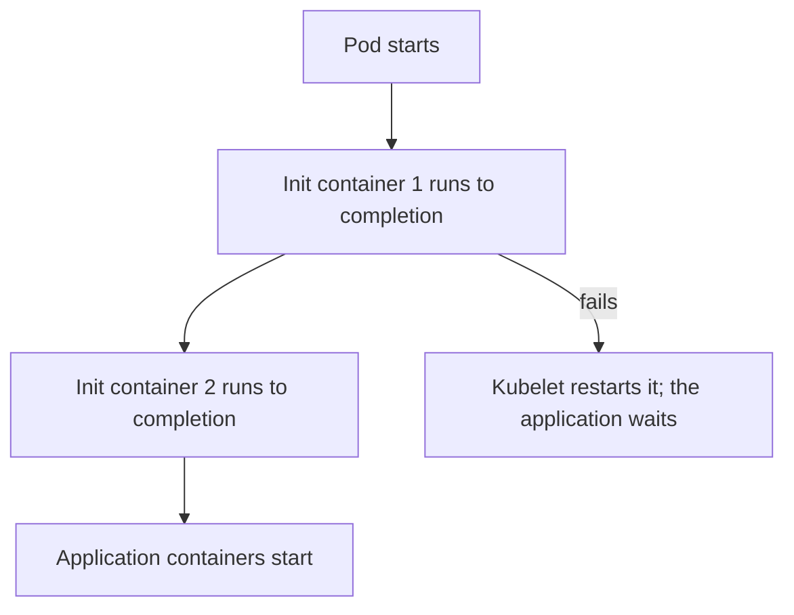

# Init Containers And Sidecar Patterns

An application needs a generated configuration file before it starts, and it needs a helper that ships its logs while it runs. Putting both jobs into the application image mixes unrelated tools and releases. A Pod can hold several containers that share a network and volumes, so each job can be its own container with its own image. This part explains the two kinds of helper container: the init container, which prepares, and the sidecar container, which assists.

## Init containers

An init container is a container that runs to completion before the application containers start. A Pod can have several, and they run one at a time in the order they are listed. Each must exit with status 0 before the next starts. When all have succeeded, the application containers start together.

If an init container fails, the kubelet restarts it according to the Pod `restartPolicy`, and the application containers do not start. The Pod status shows the progress as `Init:0/1`, and `Init:Error` or `Init:CrashLoopBackOff` after failures. Init containers are therefore the right place for work that must finish before the application runs: waiting for a dependency, running a database migration, downloading or generating files, or setting file permissions.

Init containers use their own image. A tool that is needed only at start, such as a client for downloading files, does not have to be in the application image. They share the Pod volumes, which is how they hand files to the application.


Application containers never start while an init container is failing.

## Run an init container

Save this as `pod-builder.yaml`:

```yaml
apiVersion: v1
kind: Pod
metadata:
  name: builder
  namespace: starfleet
spec:
  volumes:
    - name: work
      emptyDir: {}
  initContainers:
    - name: prepare
      image: busybox:1.37.0
      command: ["sh", "-c", "echo mission=ready > /work/config.txt"]
      volumeMounts:
        - name: work
          mountPath: /work
  containers:
    - name: app
      image: busybox:1.37.0
      command: ["sh", "-c", "cat /work/config.txt; sleep 3600"]
      volumeMounts:
        - name: work
          mountPath: /work
```

Apply it:

<!-- astrona:playground:renew -->

```sh
kubectl apply -f pod-builder.yaml
kubectl -n starfleet wait --for=condition=Ready pod/builder --timeout=120s
```

Then check the result:

```sh
kubectl -n starfleet logs builder -c app
kubectl -n starfleet get pod builder -o jsonpath='{.status.initContainerStatuses[0].state.terminated.reason}{"\n"}'
```

The log of the application shows the line that the init container wrote, because both containers mount the same `emptyDir` volume. The second command prints `Completed`, the reason of the finished init container.

## A failing init container

Change the command of the init container so that it fails. Save this as `pod-stuck.yaml`:

```yaml
apiVersion: v1
kind: Pod
metadata:
  name: stuck
  namespace: starfleet
spec:
  initContainers:
    - name: prepare
      image: busybox:1.37.0
      command: ["sh", "-c", "cp /missing/input.txt /tmp/input.txt"]
  containers:
    - name: app
      image: busybox:1.37.0
      command: ["sleep", "3600"]
```

```sh
kubectl apply -f pod-stuck.yaml
kubectl -n starfleet get pod stuck
kubectl -n starfleet logs stuck -c prepare
```

The Pod is not `Running`. Its status shows an `Init` state with errors, and the application container has not started at all. The log of the init container names the file that does not exist. Reading the log of the application container would show nothing, so the init container is the place to look.

## Sidecar containers

A sidecar is a container that runs beside the application container for the life of the Pod. It adds a function without changing the application: shipping logs, refreshing credentials, proxying network traffic or collecting metrics. It shares the network namespace and can share volumes. Three classic patterns use the same shape. A sidecar extends the application. An adapter converts its output, for example into another log or metric format. An ambassador proxies its connections to the outside.

Before Kubernetes 1.29 a sidecar was an ordinary second container. That has two weaknesses: the sidecar can start after the application, and in a Job the Pod never finishes while the sidecar still runs. Kubernetes now supports native sidecars. A native sidecar is an init container with `restartPolicy: Always`. It starts in the init order, so it is running before the application starts, it keeps running while the application runs and it is restarted if it exits. It is stopped after the application containers when the Pod ends.

Save this as `pod-shipper.yaml`:

```yaml
apiVersion: v1
kind: Pod
metadata:
  name: shipper
  namespace: starfleet
spec:
  volumes:
    - name: logs
      emptyDir: {}
  initContainers:
    - name: tail
      image: busybox:1.37.0
      restartPolicy: Always
      command: ["sh", "-c", "touch /logs/app.log; tail -f /logs/app.log"]
      volumeMounts:
        - name: logs
          mountPath: /logs
  containers:
    - name: app
      image: busybox:1.37.0
      command: ["sh", "-c", "while true; do date >> /logs/app.log; sleep 5; done"]
      volumeMounts:
        - name: logs
          mountPath: /logs
```

```sh
kubectl apply -f pod-shipper.yaml
kubectl -n starfleet wait --for=condition=Ready pod/shipper --timeout=120s
kubectl -n starfleet logs shipper -c tail
```

The log of the sidecar shows the lines that the application appends. The Pod is ready only when the sidecar has started and the application is ready.

## Choose the pattern

Use an init container when the work must finish before the application starts and then stop. Use a sidecar when the helper must run for as long as the application does. If the helper only needs the same host and volume but no ordering, a second ordinary container works. Do not put the helper into the application image just to save a container, because then the two cannot be updated or restarted separately.

You now know how a Pod can be assembled from containers with separate jobs. Remove the test Pods:

```sh
kubectl -n starfleet delete pod builder stuck shipper
```

## Common pitfalls

> [!WARNING]
> - **Reading the application log when an init container fails.** The application never started. Read the init container log with `-c`.
> - **Expecting init containers to run in parallel.** They run one after another, each to completion.
> - **Using an init container for a long-running helper.** Init containers must exit. Use a sidecar.
> - **Forgetting the shared volume.** Containers see each other files only through a volume that both mount.
