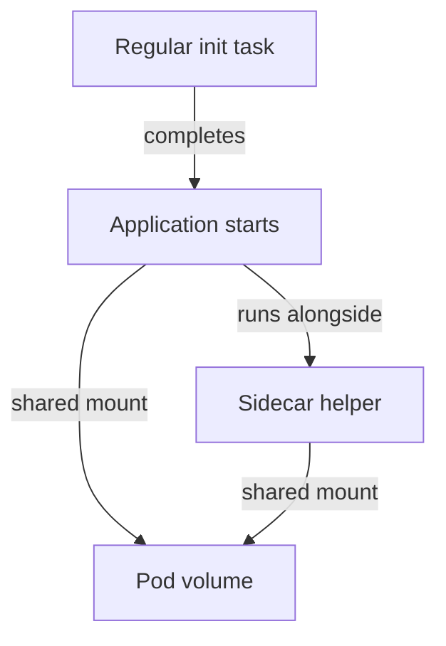

# Init Containers And Sidecar Patterns

Before `scout` starts, a preparation task must create a file in a shared volume. A regular init container runs before the application containers and must complete successfully. Multiple regular init containers run in their defined order. If initialization cannot finish, the application does not begin normal execution.

A sidecar pattern places a supporting container beside the main application in the same Pod. The helper might forward logs or proxy requests while the application runs. It shares the Pod's lifecycle and network context, which is useful when the two processes need close coordination. An unrelated application with its own scaling needs usually belongs in a separate workload.

Kubernetes also supports restartable init containers for native sidecar behavior. An init container with the supported restart policy can keep running after startup and support ordering relative to other initialization and application containers. This differs from a regular init container, which is expected to finish before normal application startup.

Shared placement does not automatically share files. Both containers need a volume mounted where their processes expect it. They must also avoid conflicting listener ports because the Pod shares a network namespace. Each container has its own image and resource settings.

A completion task gates startup, while a sidecar supports the running application through explicitly shared resources.

Choose the pattern from duration and coupling. A one-time file preparation step fits a regular init container. Continuous log forwarding fits a sidecar. A separately scalable report processor does not become a sidecar merely because it communicates with the application.

## One-Time Preparation Versus Ongoing Support

Suppose a regular init container writes generated settings to a volume. The main process reads those settings from the same volume. The initializer's image filesystem is separate, so merely writing to an unmounted local directory does not deliver the file. Both containers need mounts that expose the shared data at the expected paths.

Regular init ordering can express dependencies between preparation tasks: download data, transform it, then start the application. Each task must finish successfully. A loop that waits forever for a dependency can block the application indefinitely, so bounded waits and useful failure evidence matter. Initialization cannot guarantee that an external dependency will remain available after startup.

A sidecar provides ongoing support, such as log forwarding or proxying. Its resource consumption contributes to the Pod's needs, and its failures can affect the application even if the main process remains alive. Putting a helper in the same Pod can simplify local communication but couples its placement and replacement to the application.

## Native Sidecar Ordering And Independent Services

A restartable init container uses supported native sidecar behavior rather than regular completion semantics. It can start as part of initialization and continue while application containers run. Startup checks can participate in deciding when subsequent initialization proceeds. This provides an explicit lifecycle contract rather than relying only on two ordinary containers racing to become ready.

A separately scalable backend belongs in its own workload when it serves many application replicas or has independent resource and lifecycle needs. Co-location is not a default for every communicating component. A database used by twenty web replicas should not become twenty uncoordinated helper containers merely to avoid networking.

Choose the container pattern from startup order, duration, shared resources and ownership. A one-time dependency task, an ongoing per-instance helper and an independently operated service are different designs. Their differences determine both startup behavior and the consequences of replacing a Pod.

## Common pitfalls

> [!WARNING]
> A regular init container must finish; a sidecar supports ongoing execution. Containers in the same Pod do not automatically share their image filesystems.
